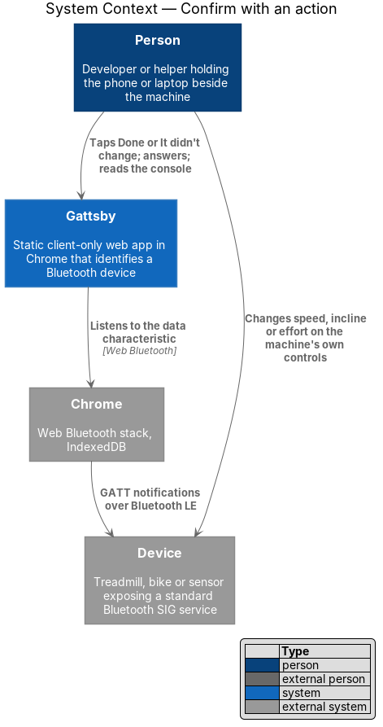
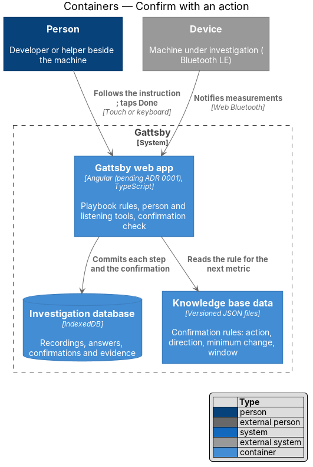
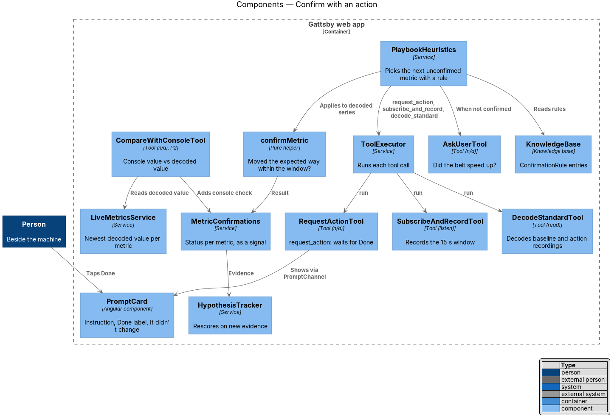
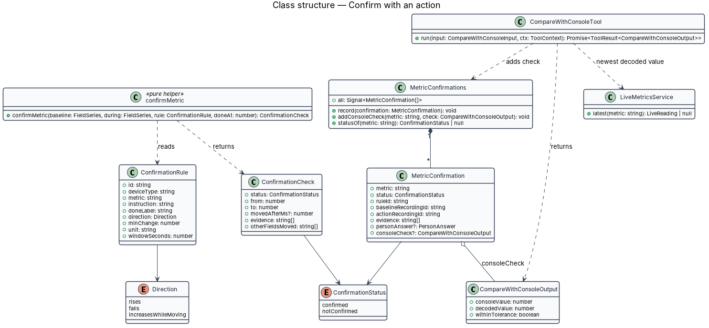
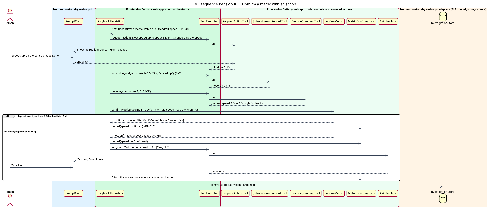
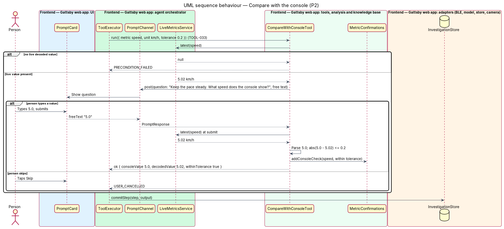

# Confirm with an action

## Overview

A decoder can read a field that the specification calls "instantaneous speed" and still be wrong
about the device: a machine may fill the field with zeros, send a different unit, or put the value
somewhere else. Gattsby therefore does not trust a decoded metric until it has watched it respond to
something the person did. This feature asks the person for a known action on the machine (walk
faster, pedal harder, raise the incline on the console) and checks, with deterministic code, that the
matching decoded metric moves the expected way within 15 seconds. Only then is the metric
*confirmed*. It belongs to the standard-protocols subsystem and runs in the Standard path stage of
the playbook, after [decode standard data](../decode-standard-data/README.md) has produced decoded
values.

**known action** — physical change the person makes on the machine's own controls whose effect on
one metric is predictable, for example "speed up to about 6 km/h"

**confirmation rule** — knowledge-base entry that pairs a metric with its known action, the expected
direction of change, the smallest change that counts, and the window in which the change counts

**confirmation window** — 15 seconds from the person's "Done", in which the metric moves
the expected way for it to count (A-12)

**confirmed** — status of a metric whose decoded value moved the expected way within the
confirmation window

**not confirmed** — status of a metric whose decoded value did not move the expected way within the
window, or whose action the person skipped

**console comparison** — second check, at P2, in which the person reads a value off the machine's
own console and Gattsby compares it with the decoded value at that moment (`compare_with_console`,
TOOL-033)

The investigation mock (`docs/mocks/pages/investigation/default.html`) shows the flow on the Horizon
T202: the agent asks "Now speed up to about 6 km/h. Change only the speed.", the person answers
"Done, at 6", and the feed reports "Speed went 3.0 → 6.0 km/h within 2 s. Incline did not move."
with speed *confirmed* and the hypothesis rising from 65 % to 85 %. The dock in the same mock holds
the next rule's prompt, "Raise the incline to 2%", with "Incline is at 2%" and "It didn't change".
The evidence log mock (`docs/mocks/pages/evidence/default.html`) records "Speed confirmed (3.0 → 6.0)"
beside the notifications that showed it. FR-025 AC3 ties the feature to the verdict: an FTMS
treadmill whose speed and distance are confirmed can be reported as "Connected — FTMS".

## Description

The design introduces these building blocks in the Angular (pending ADR 0001) workspace under
`frontend/src/app/`:

- **`ConfirmationRule`** (`knowledge-base/data/confirmations.json`, typed in
  `knowledge-base/confirmation-rule.ts`) — data, not code. Each entry names the device type, the
  metric, the instruction shown to the person, the label of the "Done" button, the expected direction
  (`rises`, `falls` or `increases while moving`), the minimum change in the metric's unit, and the
  window (15 seconds). A-12 supplies two entries: treadmill speed rises by at least 0.5 km/h, and
  distance increases while the belt moves. The thresholds for cadence, power, resistance, incline
  and heart rate are `<TO SUPPLY>`; until they are supplied, those metrics stay *not confirmed* and
  their rules are absent, so `PlaybookHeuristics` does not ask for them.
- **`PlaybookHeuristics`** (`agent/playbook-heuristics.ts`) — in the Standard path stage, picks the
  next decoded metric that has a confirmation rule and is not yet confirmed, in the rule file's
  order (speed before distance before incline for a treadmill). The model is not consulted for this
  choice (FR-046). In checklist mode `ChecklistRunner` runs the same rule order.
- **`RequestActionTool`** (`tools/person/request-action.tool.ts`) — shows the rule's instruction and
  waits for "Done" (see [request a physical action](../../person-interaction/request-a-physical-action/README.md)).
  The prompt's "Done" button carries the rule's label ("Incline is at 2%"), and its skip button reads
  "It didn't change".
- **`SubscribeAndRecordTool`** (`tools/listening/subscribe-and-record.tool.ts`) — records the data
  characteristic for the confirmation window, starting at "Done", labelled with the action. The
  baseline is the recording taken before the instruction (in the mock, "walking").
- **`DecodeStandardTool`** (`tools/analysis/decode-standard.tool.ts`) — decodes the baseline and the
  action recording; its per-field series give the values the check compares.
- **`confirmMetric`** (`analysis/confirm-metric.ts`) — pure helper. Input: the baseline series, the
  action series with timestamps, and the rule. It takes the baseline's last value as the reference,
  finds the first action value that differs from it by at least the rule's minimum in the expected
  direction, and returns `confirmed` with the time from "Done" to that value and the raw-log entry
  IDs that show it, or `notConfirmed` with the largest change seen. It also reports which other
  decoded fields moved beyond their resolution, so the summary can say "Incline did not move".
- **`MetricConfirmations`** (`outcome/metric-confirmations.ts`) — holds one `MetricConfirmation` per
  metric for the running investigation, as a signal. It is read by the live readings (the
  *confirmed* tag, see [show live metrics](../show-live-metrics/README.md)), by `HypothesisTracker`
  for scoring (see [track the hypothesis](../../outcome/track-the-hypothesis/README.md)), and by
  `ReadableMetricsBuilder` for the profile (see
  [determine readable metrics](../determine-readable-metrics/README.md)).
- **`AskUserTool`** (`tools/person/ask-user.tool.ts`) — when a metric is not confirmed, asks the
  person whether the machine changed (FR-025 AC2), for example "Did the belt speed up?" with "Yes",
  "No" and "Don't know". The answer is stored with the confirmation as evidence; it does not change
  the status.
- **`CompareWithConsoleTool`** (`tools/person/compare-with-console.tool.ts`, P2) — the
  `compare_with_console` tool. Its precondition is that the metric is decoded from a live
  subscription (`LiveMetricsService` has a current reading for it); otherwise it returns
  `PRECONDITION_FAILED`. It posts a `question` prompt that asks the person to keep the pace steady
  and type the value the console shows, with free text only. When the person submits, it takes the
  newest decoded value from `LiveMetricsService`, parses the typed value as a decimal number, and
  returns `consoleValue`, `decodedValue` and `withinTolerance` (`|console − decoded| ≤ tolerance`).
  A skip or cancel returns `USER_CANCELLED`. No mock exists for this prompt yet (`<TO SUPPLY>`).

### Rules

1. A metric is *confirmed* only by `confirmMetric` on decoded live data. A person's "Yes, it sped
   up", a console comparison within tolerance, or the model's opinion does not confirm a metric;
   each is recorded as supporting evidence only (FR-025).
2. The window starts at "Done" and lasts 15 seconds. A machine that ramps its belt over several
   seconds still confirms within the window; the mock's "within 2 s" is the measured time to the
   first qualifying value.
3. Each instruction asks for one change ("Change only the speed"), so a move in another field is
   reported, not treated as the confirmed metric.
4. A skipped action ("It didn't change", or "Skip") leaves the metric *not confirmed*, records the
   skip as an observation (see [skip a step](../../person-interaction/skip-a-step/README.md)), and
   does not ask the follow-up question.
5. Every confirmation is an observation with evidence: the rule, the baseline and action recording
   IDs, and the raw-log entries of the qualifying values. The verdict screen's "Evidence" link next
   to a metric opens those entries (FR-056).
6. Confirmation asks for no `write` or `control` call. The person changes the machine with its own
   controls; Gattsby only listens.
7. The console comparison never replaces the trend check. A comparison outside tolerance is recorded
   against the metric's scale or unit and is raised for the hypothesis, not as a failure of the
   confirmation.

### Data shapes

| Type | Fields |
|---|---|
| `ConfirmationRule` | `deviceType`, `metric`, `instruction`, `doneLabel`, `direction`, `minChange`, `unit`, `windowSeconds` |
| `MetricConfirmation` | `metric`, `status` (`confirmed` \| `notConfirmed`), `ruleId`, `baselineRecordingId`, `actionRecordingId`, `from`, `to`, `movedAfterMs?`, `evidence`, `personAnswer?`, `consoleCheck?` |
| `CompareWithConsoleInput` | `metric`, `unit`, `tolerance` |
| `CompareWithConsoleOutput` | `consoleValue`, `decodedValue`, `withinTolerance` |

### Errors

| Code | Raised by | Meaning to the person |
|---|---|---|
| `TIMEOUT` | `RequestActionTool` | "Still there?" after 2 minutes without "Done" (FR-051). |
| `INSUFFICIENT_DATA` | `confirmMetric` via the orchestrator | The action recording holds no decoded value for the metric; the metric stays *not confirmed* and the feed says so. |
| `USER_CANCELLED` | `CompareWithConsoleTool` | None; the comparison is optional. |
| `PRECONDITION_FAILED` | `CompareWithConsoleTool` | Not shown; the metric has no live decoded value to compare. |

### Tests that prove it

The acceptance specs use the fake `navigator.bluetooth` (`e2e/fixtures/fake-bluetooth.ts`) with the
scripted FTMS treadmill, the fake `LanguageModel` (`e2e/fixtures/fake-language-model.ts`) and the
`InvestigationPage` page object.

- FR-025 AC1: the treadmill script raises speed from 3.0 to 6.0 km/h 2 seconds after the spec taps
  "Done"; the spec checks that speed reads *confirmed*.
- FR-025 AC2: the treadmill script keeps speed flat; under Playwright's clock the spec advances 15
  seconds and checks that speed reads *not confirmed*, the question "Did the belt speed up?" is
  shown, and the answer appears in the evidence log.
- FR-025 AC3: with speed and distance confirmed, the spec reaches the verdict "Connected — FTMS", in
  full agent mode and in checklist mode.
- TOOL-033 AC1 (P2): with decoded speed at 5.02 km/h, the spec types 5.0 and checks that the result
  is within tolerance 0.2.

Unit tests cover `confirmMetric` with a fake clock: a rise of exactly 0.5 km/h, a rise of 0.4 km/h,
a rise at 15.1 seconds, a fall when a rise is expected, and a recording with no value for the metric.

## Requirements

The feature realizes the following level-2 (L2) requirements; each refines the level-1 (L1)
requirement cited beside it.

| L2 ID | Refines (L1) | Requirement |
|-------|--------------|-------------|
| [`FR-025`](../../../specs/L2.md#fr-025-confirm-decoded-values-with-a-physical-action) | `L1-007` | Gattsby must ask the person for a known action (walk faster, pedal harder, increase incline on the console) and must confirm that the matching decoded metric moves the expected way within 15 seconds. A metric counts as *confirmed* only when it does. |
| [`TOOL-033`](../../../specs/L2.md#tool-033-compare_with_console) | `L1-007` | Asks the person to read a value from the machine's own console and compares it with the decoded value at that moment, as a second confirmation beside FR-025's trend check. |

## Diagrams

### System context

The person changes the machine with its own controls and tells Gattsby when it is done; Gattsby
listens to the device's data through Chrome and judges whether the decoded value followed.

### Containers

The web app reads the confirmation rules from the knowledge base, records the device's data, and
commits each confirmation and its evidence to the investigation database.

### Components

`PlaybookHeuristics` picks the rule; the person tools ask and wait; the listening and analysis tools
record and decode; `confirmMetric` decides, and `MetricConfirmations` publishes the result to the
hypothesis, the live readings and the profile.

### Class structure

`confirmMetric` turns two decoded series and a `ConfirmationRule` into a `MetricConfirmation`, which
`MetricConfirmations` owns; `CompareWithConsoleTool` adds a console check to it.

### Behaviour — confirm a metric

The person speeds up and taps "Done"; a 15-second recording is decoded and speed is *confirmed* when
it rises by at least 0.5 km/h, or *not confirmed* with a follow-up question when it does not.

### Behaviour — compare with the console (P2)

The person types the speed the console shows; the tool compares it with the newest decoded value and
records the result beside the trend check.

