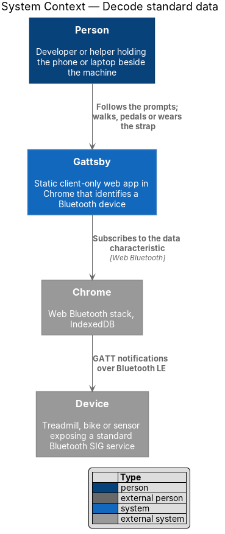
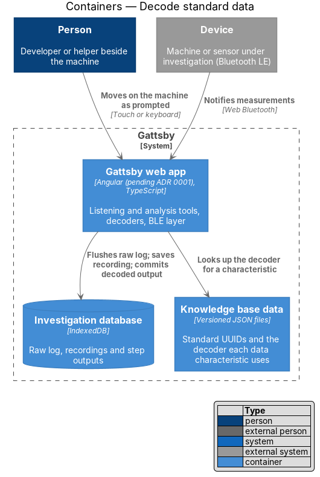
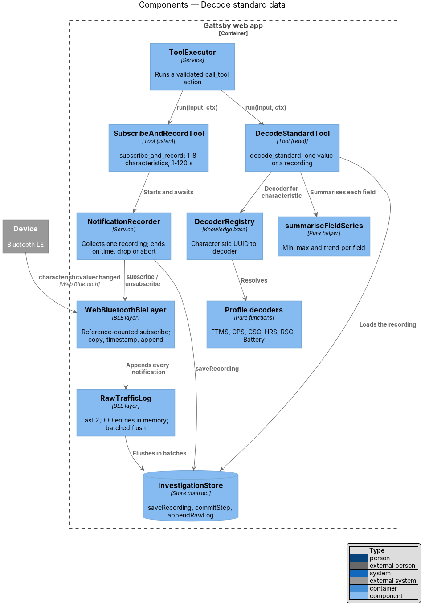
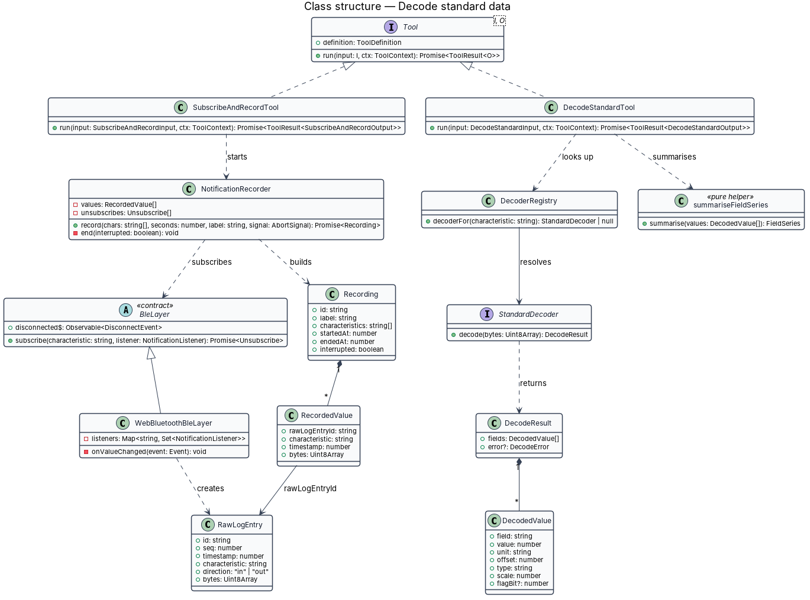
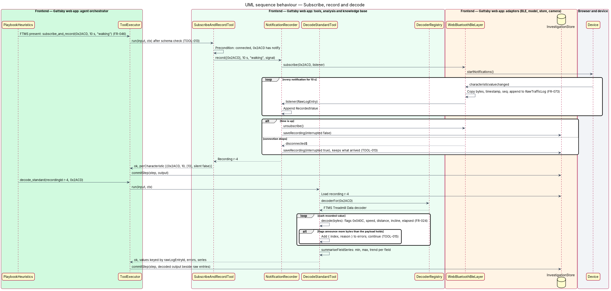
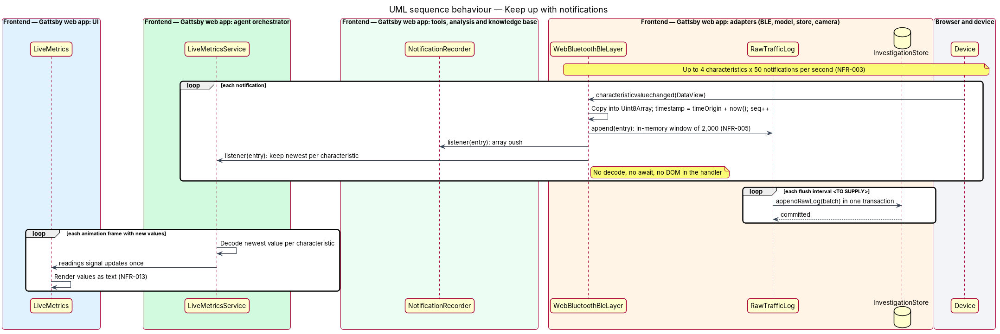

# Decode standard data

## Overview

Most fitness machines and sensors that software can already talk to expose a published Bluetooth
SIG profile: Fitness Machine Service (FTMS), Cycling Power, Cycling Speed and Cadence, Heart Rate,
Running Speed and Cadence, and Battery. When a device has one of these services, Gattsby does not
guess its byte layout; the layout is in the specification and the knowledge base holds a
decoder for it. This feature subscribes to the profile's data characteristic, records every
notification with its timestamp, decodes each payload with the knowledge base's decoder, and stores
the decoded fields beside the raw bytes they came from. It belongs to the standard-protocols
subsystem and runs in the Standard path stage of the playbook, after the Identify stage has found a
standard service.

**standard service** — Bluetooth SIG service whose data characteristic the knowledge base can decode:
FTMS (`0x1826`), Cycling Power (`0x1818`), Cycling Speed and Cadence (`0x1816`), Heart Rate
(`0x180D`), Running Speed and Cadence (`0x1814`) or Battery (`0x180F`)

**data characteristic** — characteristic of a standard service that notifies or indicates the
device's measurements, for example Treadmill Data (`0x2ACD`), Indoor Bike Data (`0x2AD2`) or Heart
Rate Measurement (`0x2A37`)

**recording** — labelled, time-bounded set of notifications captured from one or more
characteristics by `subscribe_and_record`, stored with each value's timestamp and raw-log entry

**decoder** — pure function in the knowledge base that turns one payload of a data characteristic
into named fields with units, or reports why the payload does not fit

**decoded field** — one value read from a payload, with its name, value, unit, byte offset, type and
scale

**flag rule** — rule by which a payload's flags field decides whether an optional field is present
and where it starts

Two tools carry the feature. `subscribe_and_record` (`listen` safety class) enables notifications on
up to 8 characteristics and records every value for 1 to 120 seconds. `decode_standard` (`read`
safety class, Analysis group) decodes either one value or a whole recording, and over a recording
also returns each field's minimum, maximum and trend. Neither tool writes to the device. In the
investigation mock (`docs/mocks/pages/investigation/default.html`) the two appear in the activity
feed as "Record Treadmill Data while you walk" and "Compare speed before and after your change". The
evidence log mock (`docs/mocks/pages/evidence/default.html`) shows a Treadmill Data notification
`0C 04 2C 01 08 00 00 00 00 00 00 34 00` beside its decoding: flags `0x040C`, speed 3.00 km/h,
distance 8 m, incline 0.0 %, ramp 0.0° and elapsed time 52 s.

The rate the feature handles is fixed by NFR-003: up to 50 notifications per second on each of up
to 4 characteristics, with none dropped and the UI never held back by more than one frame. The
design keeps the notification handler to a copy, a timestamp and an append, and moves decoding and
rendering off that path.

## Description

The design introduces these building blocks in the Angular (pending ADR 0001) workspace under
`frontend/src/app/`:

- **`SubscribeAndRecordTool`** (`tools/listening/subscribe-and-record.tool.ts`) — the
  `subscribe_and_record` tool. Its preconditions check that the device is connected and that each
  characteristic has `notify` or `indicate`. It starts one `NotificationRecorder`, waits for the
  requested seconds on the injected `Clock`, saves the recording and returns the per-characteristic
  counts, payload lengths and `silent` flags.
- **`NotificationRecorder`** (`tools/listening/notification-recorder.ts`) — records one recording. It
  calls `BleLayer.subscribe` for each characteristic and appends each delivered `RawLogEntry` to an
  in-memory list bounded by the recording's length (at most 120 seconds, NFR-005). On a
  `disconnected$` event it ends early and marks the recording `interrupted`. On every end path it
  calls the unsubscribe handles and clears its timer. The proprietary path's `baseline_vs_activity`
  uses the same recorder (see
  [record a baseline and activity levels](../../proprietary-analysis/record-baseline-and-activity/README.md)).
- **`WebBluetoothBleLayer.subscribe`** (`ble/web-bluetooth-ble-layer.ts`) — the only path to
  `startNotifications`. It is reference-counted per characteristic, so a recording and the live
  readings (see [show live metrics](../show-live-metrics/README.md)) can listen to the same
  characteristic, and notifications stop only when the last listener unsubscribes. Its
  `characteristicvaluechanged` handler does three things and returns: it copies the bytes into a new
  `Uint8Array`, stamps a high-resolution timestamp (`performance.timeOrigin + performance.now()`) and
  a per-connection sequence number, and appends the entry to `RawTrafficLog` before handing it to
  each listener. It does not decode, await or touch the DOM.
- **`RawTrafficLog`** (`ble/raw-traffic-log.ts`) — keeps the last 2,000 entries in memory and flushes
  the rest to the store in batches (see [log raw traffic](../../tool-registry/log-raw-traffic/README.md)).
  Every notification is logged whether or not a recording is running (FR-073).
- **`DecodeStandardTool`** (`tools/analysis/decode-standard.tool.ts`) — the `decode_standard` tool. It
  needs no connection. Given `hex`, it decodes one value and fails with `DECODE_ERROR` if the bytes
  do not fit. Given `recordingId`, it loads the recording, decodes every value of the named
  characteristic, lists each payload that does not fit in `errors` with its index and reason, and
  keeps decoding the rest (TOOL-015 AC3). It then computes each field's minimum, maximum and trend.
- **`DecoderRegistry`** (`knowledge-base/decoders/decoder-registry.ts`) — maps a data characteristic
  UUID, through the knowledge base's `uuids.json` entry, to its decoder in
  `knowledge-base/decoders/` (`ftms.decoder.ts`, `cps.decoder.ts`, `csc.decoder.ts`,
  `hrs.decoder.ts`, `rsc.decoder.ts`, `battery.decoder.ts`). Adding a decoder is a data entry plus a
  pure function; the agent loop does not change (NFR-022).
- **Decoders** — pure functions `(bytes: Uint8Array) => DecodeResult`. Each reads the flags field,
  walks the optional fields in specification order, and checks the remaining length before every
  read. A payload whose flags announce more bytes than it holds returns a `DecodeError` naming the
  field that ran short ("flags announce elapsed time at offset 11, payload holds 11 bytes") instead
  of throwing (FR-024 AC3). All values are little-endian, as the SIG profiles define them.
- **`summariseFieldSeries`** (`analysis/summarise-field-series.ts`) — pure helper that turns one
  field's decoded values over a recording into `min`, `max` and `trend` (`rising`, `falling`,
  `steady` or `mixed`), comparing the change against the field's resolution (its scale). The model
  and the person read the trend, never the bytes.

### Rules

1. The model never decodes. It may ask for `decode_standard`; the decoder is deterministic code, and
   only the tool's one-line summary (at most 200 characters, FR-044) reaches the model's state.
2. `PlaybookHeuristics` chooses the data characteristic without the model: when a standard service
   is present, the Standard path stage subscribes to its data characteristic first (FR-046). For a
   device with several (an FTMS treadmill with a Heart Rate service, as in the mocks), the machine's
   own data characteristic comes first.
3. Each decoded value is stored with the ID of the raw-log entry it came from. The step's full output
   is committed with `InvestigationStore.commitStep`, so the evidence log can show the raw
   notification and its decoding together, and a later profile entry can cite both (FR-056).
4. `subscribe_and_record` refuses 0 or more than 8 characteristics and fewer than 1 or more than 120
   seconds with `INVALID_INPUT`, before anything is subscribed (TOOL-013 AC2). The validation is the
   tool's input schema, checked by `ActionValidator` (see
   [validate and run an action](../../agent/validate-and-run-an-action/README.md)).
5. A characteristic that delivers nothing during the recording is reported `silent: true`; it is an
   observation, not an error.
6. A dropped connection ends the recording at once. The recording keeps what arrived and is saved
   with `interrupted: true` (TOOL-013 AC3); reconnecting is the job of
   [recover a dropped connection](../../connection/recover-a-dropped-connection/README.md).
7. Stop and emergency stop abort the step's `AbortSignal`. The recorder unsubscribes, saves what
   arrived as `interrupted`, and the tool returns `ABORTED`.
8. An encrypted or authenticated characteristic makes `startNotifications` fail with a security
   error. The BLE layer maps it to `AUTH_REQUIRED`; Gattsby records it and does not try to bypass it
   (FR-033).

### Keeping up with notifications (NFR-003)

At the NFR-003 ceiling of 4 characteristics at 50 notifications per second, the handler runs 200
times a second. The design keeps each run small and pushes everything else to a later, batched step:

| Work | Where it runs | When |
|---|---|---|
| Copy bytes, timestamp, sequence number, append to the in-memory log | `WebBluetoothBleLayer` handler | Every notification, synchronously |
| Append to the active recording | `NotificationRecorder` listener | Every notification, synchronously (an array push) |
| Write raw-log entries to IndexedDB | `RawTrafficLog` flush | In batches, one transaction per batch; batch size and interval `<TO SUPPLY>` |
| Decode for the live readings | `LiveMetricsService` | Once per animation frame, newest value per characteristic |
| Decode every value of a recording | `DecodeStandardTool` | After the recording ends, as its own step |

Ordering is the arrival order of `characteristicvaluechanged` events. The sequence number makes it
checkable after the fact, and the timestamp has at least millisecond resolution (FR-073 AC2).

### Data shapes

| Type | Fields |
|---|---|
| `SubscribeAndRecordInput` | `characteristics` (1–8 UUIDs), `seconds` (1–120), `label?` |
| `SubscribeAndRecordOutput` | `recordingId`, `label`, `perCharacteristic: [{ uuid, count, lengths, silent }]` |
| `Recording` (`store/model/recording.ts`) | `id`, `investigationId`, `stepId`, `label`, `characteristics`, `startedAt`, `endedAt`, `interrupted`, `values: RecordedValue[]` |
| `RecordedValue` | `rawLogEntryId`, `characteristic`, `timestamp`, `bytes` |
| `DecodeStandardInput` | `recordingId?`, `characteristic`, `hex?` (exactly one of `recordingId` and `hex`) |
| `DecodedValue` (`knowledge-base/decoders/decoded-value.ts`) | `field`, `value`, `unit`, `offset`, `type`, `scale`, `flagBit?` |
| `DecodeResult` | `fields: DecodedValue[]`, `error?: DecodeError` |
| `DecodeStandardOutput` | `values: [{ rawLogEntryId?, fields }]`, `errors: [{ index, reason }]`, `series?: [{ field, unit, min, max, trend }]` |

`DecodedValue.field` is the `name` that TOOL-015's output lists. The output keeps TOOL-015's
`fields` and `errors` per value and adds `series` for a recording.

### Errors

| Code | Raised by | Meaning to the person |
|---|---|---|
| `NOT_CONNECTED` | `SubscribeAndRecordTool` precondition | "The machine isn't connected." The connection banner offers a reconnect. |
| `PROPERTY_MISSING` | `SubscribeAndRecordTool` precondition | Not shown as an error; the activity feed says the characteristic does not send data. |
| `AUTH_REQUIRED` | `WebBluetoothBleLayer.subscribe` | "This data is protected. Gattsby won't try to get around that." Recorded for a missing-tool request. |
| `INVALID_INPUT` | `ActionValidator`, `DecodeStandardTool` | Not shown; the model sees the reason in its next state. Also raised when `characteristic` has no standard decoder. |
| `STORAGE_FULL` | `InvestigationStore.saveRecording` | The storage toast (NFR-008). |
| `DECODE_ERROR` | `DecodeStandardTool`, single value only | Not shown as an error; the evidence log shows the raw bytes with "Doesn't fit the standard layout". |
| `ABORTED` | `NotificationRecorder` | None; stop or emergency stop already explained it. |

### Tests that prove it

The acceptance specs use the fake `navigator.bluetooth` (`e2e/fixtures/fake-bluetooth.ts`) with
the scripted FTMS treadmill, FTMS bike and heart-rate strap, and the `InvestigationPage` and
`EvidencePage` page objects (`e2e/pages/`).

- FR-024 AC1 and AC2: the treadmill sends Treadmill Data with flags `0x040C` and the bike sends
  Indoor Bike Data; each spec checks the decoded fields and units shown beside each raw notification
  in the evidence log.
- FR-024 AC3: the treadmill script includes one truncated payload; the spec checks that the
  investigation goes on and the evidence log marks that notification as not fitting.
- NFR-003: the fake device sends 50 notifications per second on 4 characteristics for 60 seconds
  under Playwright's clock. The spec reads the stored raw log and checks 12,000 entries in sequence
  order with timestamps, and checks that no animation frame during the run took longer than two
  frame intervals.

Unit tests cover each decoder against the Bluetooth SIG specification's example payloads (FR-066),
heart rate `00 48` decoding to 72 bpm (TOOL-015 AC1), a truncated payload, `summariseFieldSeries`,
and the recorder's end paths (time up, disconnect, abort) on a fake `Clock`, including the release
of every listener and timer.

## Requirements

The feature realizes the following level-2 (L2) requirements; each refines the level-1 (L1)
requirement cited beside it.

| L2 ID | Refines (L1) | Requirement |
|-------|--------------|-------------|
| [`FR-024`](../../../specs/L2.md#fr-024-subscribe-to-and-decode-standard-data) | `L1-007` | When a standard service is present, Gattsby must subscribe to its data characteristic, decode it with the knowledge base's decoder, and record the decoded fields with the raw bytes. |
| [`NFR-003`](../../../specs/L2.md#nfr-003-keep-up-with-notifications) | `L1-019` | The BLE layer and the recorder must log and decode notifications at up to 50 per second per characteristic, across up to 4 characteristics at once, without dropping one or delaying the UI by more than one frame. |
| [`TOOL-013`](../../../specs/L2.md#tool-013-subscribe_and_record) | `L1-007` | Enables notifications or indications on the given characteristics and records every value with a timestamp for N seconds, with an optional label. |
| [`TOOL-015`](../../../specs/L2.md#tool-015-decode_standard) | `L1-007` | Decodes payloads of the standard profiles with the knowledge base's decoders: FTMS (Treadmill, Indoor Bike, Rower, Cross Trainer Data; Feature; Status; Control Point responses; supported ranges), Cycling Power Measurement, CSC Measurement, Heart Rate Measurement, RSC Measurement, Battery Level. |

## Diagrams

### System context

The person moves on the machine while Gattsby listens to the device's data characteristic through
Chrome's Web Bluetooth stack.

### Containers

The web app subscribes to the device, reads the decoder mapping from the knowledge base, and writes
the raw log, the recording and the decoded step output to the investigation database.

### Components

`SubscribeAndRecordTool` drives a `NotificationRecorder` on top of the BLE layer's reference-counted
subscription; `DecodeStandardTool` reads the saved recording and decodes it through
`DecoderRegistry` and the profile decoders.

### Class structure

Both tools implement the `Tool` interface; the recorder depends on the `BleLayer` contract and owns
the `RecordedValue`s of one `Recording`; each decoder returns a `DecodeResult` of `DecodedValue`s.

### Behaviour — subscribe, record and decode

The Standard path subscribes to Treadmill Data (`0x2ACD`) for 10 seconds, saves the recording, and
decodes every value with the FTMS decoder; a truncated payload is listed in `errors`, and a dropped
connection ends the recording as `interrupted`.

### Behaviour — keep up with notifications

Each notification costs the handler one copy, one timestamp and two appends; IndexedDB writes are
batched and the live readings are decoded once per animation frame, so nothing is dropped and the
UI is not held back (NFR-003).

