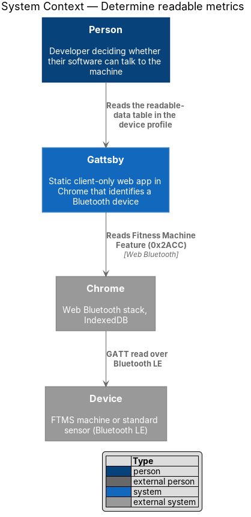
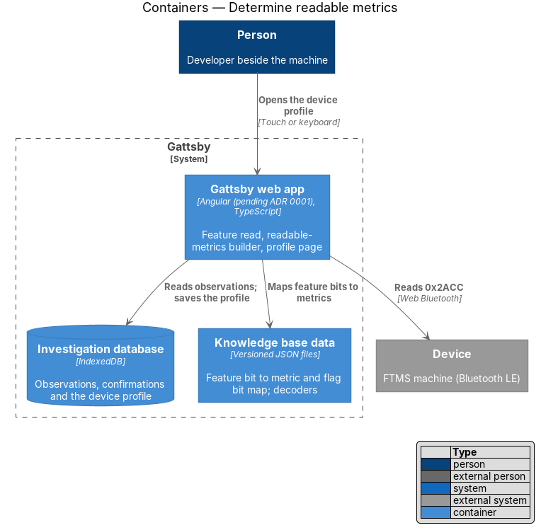
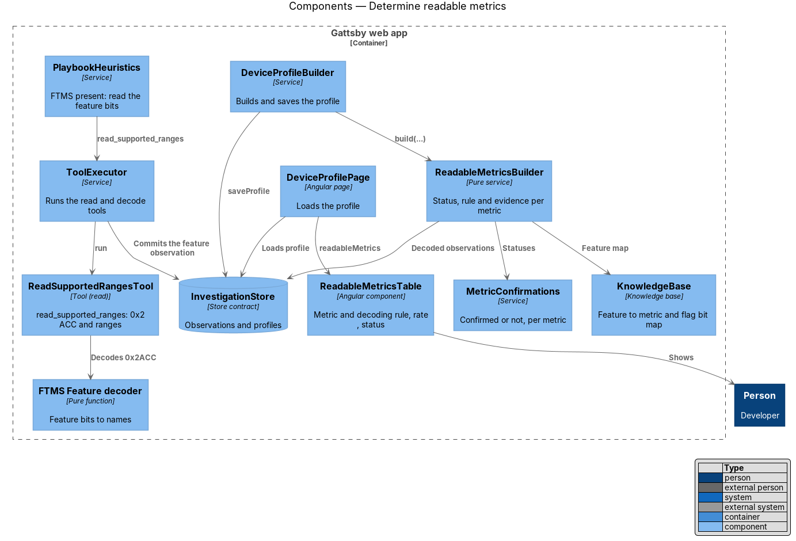
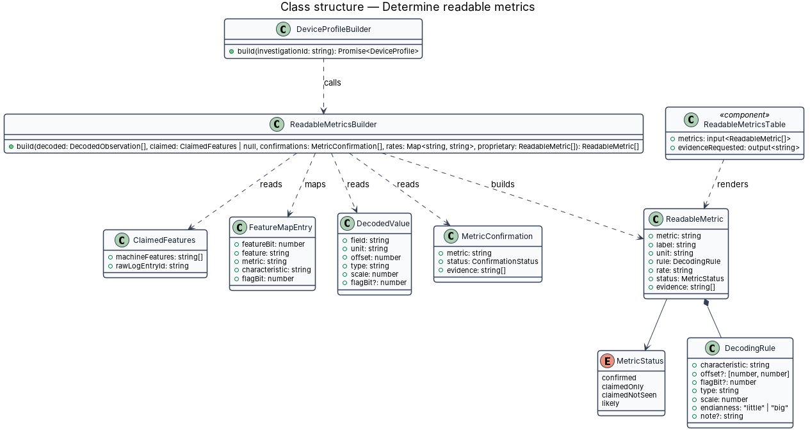
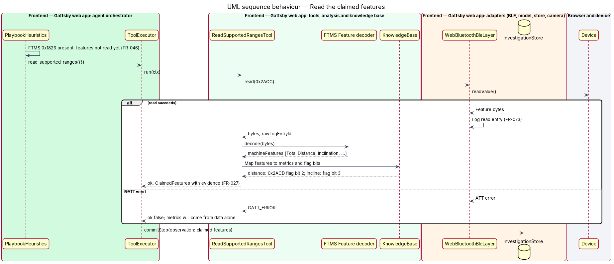
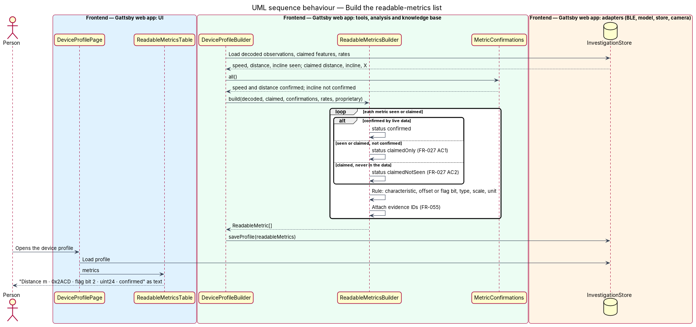

# Determine readable metrics

## Overview

The question a developer brings to a machine is "what can my software read from it, and how?". This
feature answers it in the device profile: one row per readable metric, each with the decoding rule a
developer can copy into their own code (characteristic, byte offset or flag rule, type, scale, unit)
and a status that says how far Gattsby trusts it. For an FTMS machine it also reads the Fitness
Machine Feature characteristic (`0x2ACC`), so the profile can tell apart what the device claims from
what it was seen to send and what moved when the person acted. It belongs to the standard-protocols
subsystem; the feature read runs in the Identify or Standard path stage, and the list is built in the
Conclude stage, when the device profile is built.

**readable metric** — measurement the device sends that Gattsby can decode, listed in the profile with
its decoding rule and status

**decoding rule** — characteristic, byte offset (or the flag rule that sets it), type, scale and unit
that turn a payload into one metric's value

**claimed feature** — metric that the device's Fitness Machine Feature bits say it supports

**metric status** — one of *confirmed* (moved as expected after a known action, FR-025), *claimed
only* (claimed or seen in the data, not confirmed by live data), *claimed, not seen* (claimed by
the feature bits, never present in the data), or *likely* (a proprietary field inferred by
correlation, written by the proprietary path)

The device-profile mocks show the result. The FTMS treadmill
(`docs/mocks/pages/device-profile/default.html`) lists under **Readable data**: Speed km/h
"0x2ACD · bytes 2–3 · uint16 · ×0.01" at 1 Hz, *confirmed*; Incline % "0x2ACD · flag bit 3 · sint16 ·
×0.1", *confirmed*; Distance m "0x2ACD · flag bit 2 · uint24", *confirmed*; Elapsed time s "0x2ACD ·
flag bit 10 · uint16", *confirmed*; and Heart rate bpm "0x2A37 · relays a paired strap", *claimed
only*. The partially decoded rower (`docs/mocks/pages/device-profile/partial.html`) shows the
proprietary statuses *likely* and *claimed, not seen*. Each status is a word plus a shape (filled,
half, ring, dashed), never colour alone.

## Description

The design introduces these building blocks in the Angular (pending ADR 0001) workspace under
`frontend/src/app/`:

- **Feature read** — for FTMS, `PlaybookHeuristics` (`agent/playbook-heuristics.ts`) schedules a read
  of `0x2ACC` once the FTMS service is found, without consulting the model (FR-046). The read is
  `read_supported_ranges` (TOOL-031, see
  [keep commands conservative](../../device-control/keep-commands-conservative/README.md)), which
  reads Fitness Machine Feature with the supported ranges, or `read_characteristic` (TOOL-011) when
  only the feature value is needed. Either way the bytes are decoded by the Feature decoder in
  `knowledge-base/decoders/ftms.decoder.ts` (`decode_standard`, TOOL-015), and the result is an
  observation with the read's raw-log entry as evidence.
- **Feature-to-metric map** (`knowledge-base/data/uuids.json`, FTMS entries) — data that pairs each
  Fitness Machine Feature bit with the metric it claims and with the data characteristic flag bit
  that carries it, for example "Total Distance Supported" with Treadmill Data flag bit 2, and
  "Inclination Supported" with flag bit 3. The map is versioned with the knowledge base (FR-069).
- **`ReadableMetricsBuilder`** (`outcome/readable-metrics-builder.ts`) — pure service with unit
  tests. Input: the decoded observations of the investigation (each `DecodedValue` with its
  characteristic, offset, type, scale, unit and flag bit), the claimed features, the
  `MetricConfirmation`s, the measured rate per characteristic, and the proprietary fields the
  proprietary path reports. Output: one `ReadableMetric` per metric, with its `DecodingRule`, status
  and evidence IDs. It applies the rules below in order and never asks the model.
- **`DeviceProfileBuilder`** (`outcome/device-profile-builder.ts`) — calls the builder in the
  Conclude stage, on `finish` and on every other stop (FR-045), and stores the list in the profile's
  `readableMetrics` (see [build the device profile](../../outcome/build-the-device-profile/README.md)).
- **`ReadableMetricsTable`** (`ui/readable-metrics-table/readable-metrics-table.component.ts`) —
  presentation component on the `DeviceProfilePage`. Input: `ReadableMetric[]`. It renders the table
  "Metric and decoding rule | Rate | Status" with a visually hidden caption, writes each rule as
  text in Geist Mono ("0x2ACD · flag bit 3 · sint16 · ×0.1"), and shows each status as a word plus a
  shape. It emits `evidenceRequested(metric)` for the evidence link.

### Rules

1. A metric whose `MetricConfirmation` is `confirmed` is *confirmed*.
2. A metric decoded from the data, or claimed by the feature bits, that is not confirmed is *claimed
   only* (FR-027 AC1). This covers a metric whose action the person skipped or whose check failed.
3. A metric claimed by the feature bits that never appeared in any decoded payload is *claimed, not
   seen* (FR-027 AC2). Its decoding rule still names the characteristic and flag rule from the
   knowledge base, so a developer can read it once the device sends it.
4. A field found by the proprietary path keeps the status that path gives it (*likely* or
   *confirmed*); this builder only merges it in.
5. A fixed-position field records its byte offset ("bytes 2–3"). A field whose position depends on
   earlier flags records the flag rule ("flag bit 3") instead of an offset, because its offset
   changes from payload to payload.
6. Every row carries at least one evidence ID that resolves to the investigation record: the
   notifications that decoded it, the confirmation, or the feature read (FR-055 AC2).
7. For Cycling Power, Cycling Speed and Cadence and Running Speed and Cadence, FR-027 asks for no
   feature read. Their metrics are *confirmed* or *claimed only* from the data alone; reading their
   own feature characteristics is `<TO SUPPLY>`.

### Data shapes

| Type | Fields |
|---|---|
| `ReadableMetric` | `metric`, `label`, `unit`, `rule: DecodingRule`, `rate`, `status`, `evidence` |
| `DecodingRule` | `characteristic`, `offset?` (first and last byte), `flagBit?`, `type` (`uint8`, `uint16`, `sint16`, `uint24`, …), `scale`, `endianness` (`little` for SIG profiles), `note?` (for example "relays a paired strap") |
| `MetricStatus` | `confirmed` \| `claimedOnly` \| `claimedNotSeen` \| `likely` |
| `ClaimedFeatures` | `machineFeatures: string[]`, `rawLogEntryId` |

### Errors

| Code | Raised by | Meaning to the person |
|---|---|---|
| `GATT_ERROR` | Feature read | Not shown as an error; the profile lists metrics from the data alone and the feed says the feature list could not be read. |
| `DECODE_ERROR` | Feature decoder | As `GATT_ERROR`; the raw bytes stay in the evidence log. |

### Tests that prove it

The acceptance specs use the fake `navigator.bluetooth` (`e2e/fixtures/fake-bluetooth.ts`) with the
scripted FTMS treadmill, whose feature bits claim total distance and incline, and the
`DeviceProfilePage` page object (`e2e/pages/device-profile.page.ts`).

- FR-027 AC1: after a run in which speed and distance are confirmed and incline is not, the spec
  checks that distance and incline are listed with their decoding rules, distance *confirmed* and
  incline *claimed only*.
- FR-027 AC2: a variant of the treadmill script claims one more metric in its feature bits than its
  Treadmill Data ever carries; the spec checks that this metric is listed as *claimed, not seen*.
- FR-055 AC2: the spec follows each row's evidence link and checks that it opens entries in the
  evidence log.

Unit tests cover `ReadableMetricsBuilder` for each rule, including a metric both claimed and
confirmed, a seen metric that is not claimed, and the merge of proprietary fields.

## Requirements

The feature realizes the following level-2 (L2) requirement; it refines the level-1 (L1)
requirement cited beside it.

| L2 ID | Refines (L1) | Requirement |
|-------|--------------|-------------|
| [`FR-027`](../../../specs/L2.md#fr-027-determine-readable-metrics-and-their-decoding-rules) | `L1-007` | For each readable metric Gattsby must record, in the profile, the characteristic, the byte offset (or the flag rule that sets it), the type, the scale, the unit, and whether it was confirmed by live data. For FTMS it must read Fitness Machine Feature (`0x2ACC`) to know which metrics the device claims. |

## Diagrams

### System context

Gattsby reads the device's feature bits through Chrome and gives the person a profile that lists
what can be read and how.

### Containers

The web app reads the feature map from the knowledge base, reads `0x2ACC` from the device, and
stores the readable-metrics list in the profile in the investigation database.

### Components

`PlaybookHeuristics` schedules the feature read; `ReadableMetricsBuilder` merges decoded fields,
claimed features and confirmations; `DeviceProfileBuilder` stores the list and the
`ReadableMetricsTable` shows it.

### Class structure

A `ReadableMetric` owns one `DecodingRule` and one `MetricStatus`; the builder derives them from
`DecodedValue`s, `ClaimedFeatures` and `MetricConfirmation`s.

### Behaviour — read the claimed features

When the FTMS service is found, the feature value is read, decoded and recorded as an observation
before any metric is judged.

### Behaviour — build the readable-metrics list

In the Conclude stage the builder marks each metric *confirmed*, *claimed only* or *claimed, not
seen*, attaches its decoding rule and evidence, and the profile page shows the table.

