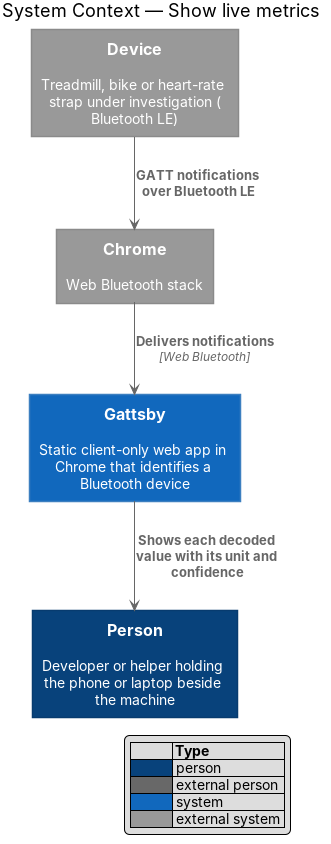
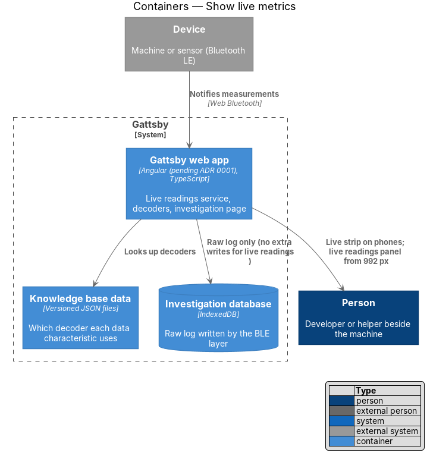
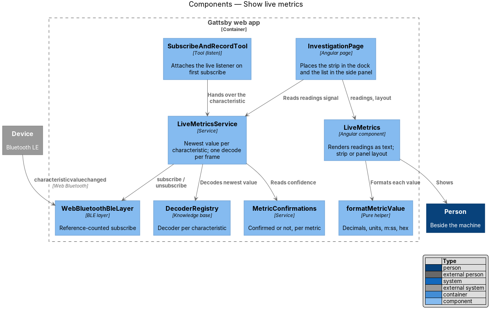
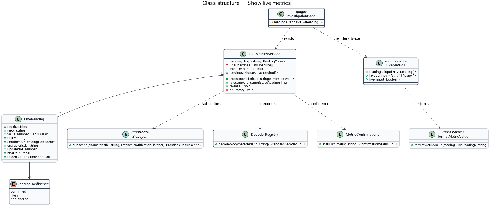
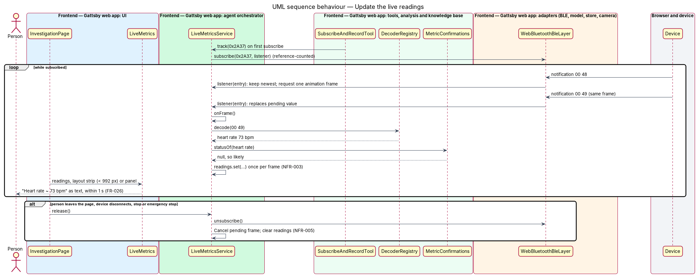

# Show live metrics

## Overview

While Gattsby listens to a device, the person sees what it is hearing: the speed the
treadmill reports, the heart rate a strap sends, a field that has not been labelled yet. Live values
let a developer judge the decoding at a glance ("the screen says 6.0 and so does the console") and
show a helper that something is happening. This feature turns each decoded notification into a
reading on the investigation screen, with its unit and its confidence, updated as notifications
arrive and large enough to read at arm's length. It belongs to the standard-protocols subsystem and
is visible from the first subscription in the Standard path stage until the device disconnects.

**live reading** — newest decoded value of one metric, with its label, unit, confidence and the time
it arrived

**live subscription** — notification listener that keeps a data characteristic notifying between
recordings so the live readings stay current

**reading confidence** — word and mark shown beside a live reading: *confirmed* (moved as expected
after a known action, FR-025), *likely* (decoded by a standard decoder, not yet confirmed, marked
"~"), or *not labelled* (bytes no decoder names yet, marked "?")

**metric under confirmation** — metric that the current action prompt asks the person to change

The investigation mock (`docs/mocks/pages/investigation/default.html`) shows both placements. On a
phone the dock above the prompt holds a horizontal **live strip** with a pulsing "Live" badge and one
reading per metric: Speed 6.0 km/h (confirmed), Incline ~ 0.0 % (likely), Distance ~ 214 m (likely),
Elapsed 2:41 (confirmed) and Field 7 ? `0x00 0x3C` (not labelled). From 992 px the strip is hidden
and the side panel shows a **Live readings** list with the rate ("1 Hz") and a confidence tag per
row. The proprietary mock (`docs/mocks/pages/investigation/proprietary.html`) uses the same strip
for packet rate, packet length and the last packet's bytes, and the control mock
(`docs/mocks/pages/investigation/control.html`) shows every reading confirmed. The mocks set live
values at 32 px on phones (NFR-009).

## Description

The design introduces these building blocks in the Angular (pending ADR 0001) workspace under
`frontend/src/app/`:

- **`LiveMetricsService`** (`agent/live-metrics.service.ts`) — owns the live readings of the running
  investigation. When `SubscribeAndRecordTool` subscribes a characteristic that has a standard
  decoder, it also attaches the service's listener through `BleLayer.subscribe`. Because the BLE
  layer counts listeners, the characteristic keeps notifying after the recording ends. The listener
  stores only the newest `RawLogEntry` per characteristic and asks for one animation frame. On that
  frame the service decodes each pending value through `DecoderRegistry`, merges the fields into its
  `readings` signal, and updates each characteristic's rate over a sliding window (`<TO SUPPLY>` seconds). It never
  decodes more than once per characteristic per frame (NFR-003).
- **`LiveReading`** (`agent/live-reading.ts`) — one row: `metric`, `label`, `value` (number or raw
  bytes), `unit`, `confidence`, `characteristic`, `updatedAt`, `rateHz` and `underConfirmation`.
  Confidence comes from `MetricConfirmations` (see
  [confirm with an action](../confirm-with-an-action/README.md)); a decoded field with no
  confirmation is *likely*. Proprietary-path readings (packet rate, length, last packet) use the same
  shape with *not labelled* (see
  [record a baseline and activity levels](../../proprietary-analysis/record-baseline-and-activity/README.md)).
- **`formatMetricValue`** (`ui/live-metrics/format-metric-value.ts`) — pure helper that formats a
  value for display: decimals from the field's scale (speed ×0.01 shows one decimal, 6.0), whole
  metres for distance, `m:ss` for elapsed time, and spaced hex bytes for a field that is not labelled.
  It returns text only.
- **`LiveMetrics`** (`ui/live-metrics/live-metrics.component.ts`) — presentation component. Inputs:
  `readings`, `layout` (`strip` or `panel`) and `live` (whether notifications are arriving). It
  injects no app service. In `strip` layout it renders the dock's live strip as a `role="group"`
  labelled "Live readings"; in `panel` layout it renders the side panel's definition list with the
  rate badge. Each reading shows its confidence as a word for assistive technology ("(likely)")
  and as a mark ("~", "?") beside the label, so colour never carries it alone.
- **`InvestigationPage`** (`pages/investigation/investigation.page.ts`) — reads
  `LiveMetricsService.readings` and passes them to two `LiveMetrics` instances, one in the dock and
  one in the side panel; CSS shows the strip below 992 px and the panel from 992 px (NFR-010).

### Rules

1. Values come from deterministic decoders only. The model never supplies a live value, a label or a
   confidence.
2. Every label and value is rendered through Angular text interpolation, never as HTML (NFR-013). A
   device-supplied or byte-derived string is text.
3. The readings signal changes at most once per animation frame. A notification is on screen by the
   next frame after it arrives, well inside FR-026's 1 second (FR-026 AC1).
4. The strip is not an ARIA live region: values change every second and would flood a screen
   reader. The dock's prompt keeps the polite live region; a confirmation is announced there, once.
5. Below 576 px the reading of the metric under confirmation is at least 48 px tall (FR-026 AC2)
   and sits first in the strip, so it is visible without scrolling.
6. The "Live" badge pulses while notifications are arriving; under `prefers-reduced-motion` it does
   not pulse. When notifications stop, the last values stay with their time. The threshold after
   which the readings count as stale, and its wording, are `<TO SUPPLY>`; no mock shows that state.
7. Leaving the investigation page, a disconnect, stop or emergency stop releases the live
   subscription: the service calls each unsubscribe handle, cancels its pending animation frame and
   empties its readings (NFR-005).

### Data shapes

| Type | Fields |
|---|---|
| `LiveReading` | `metric`, `label`, `value`, `unit?`, `confidence` (`confirmed` \| `likely` \| `notLabelled`), `characteristic`, `updatedAt`, `rateHz`, `underConfirmation` |
| `LiveMetrics` inputs | `readings: LiveReading[]`, `layout: 'strip' \| 'panel'`, `live: boolean` |

### Tests that prove it

The acceptance specs use the fake `navigator.bluetooth` (`e2e/fixtures/fake-bluetooth.ts`) with the
scripted heart-rate strap and FTMS treadmill, and the `InvestigationPage` page object, which owns
the live-strip and live-readings selectors.

- FR-026 AC1: the strap sends Heart Rate Measurement at 1 Hz with changing values; under
  Playwright's clock the spec checks after each notification that the shown BPM equals the sent
  value within 1 second.
- FR-026 AC2: at a 360 px viewport, during the "speed up" prompt, the spec checks that the speed
  reading's box is at least 48 px tall.
- NFR-013: the fake device sends a value that a formatter could mistake for markup through a
  not-labelled field; the spec checks that it is shown literally.

Unit tests cover `formatMetricValue` for each unit and scale, and `LiveMetricsService` with a fake
animation-frame scheduler: several notifications in one frame produce one decode and one signal
update, and release cancels the pending frame.

## Requirements

The feature realizes the following level-2 (L2) requirement; it refines the level-1 (L1)
requirement cited beside it.

| L2 ID | Refines (L1) | Requirement |
|-------|--------------|-------------|
| [`FR-026`](../../../specs/L2.md#fr-026-show-live-metrics) | `L1-007` | While a device is subscribed, Gattsby must show each decoded metric with its unit, updated as notifications arrive, readable at arm's length. |

## Diagrams

### System context

The device notifies through Chrome; Gattsby shows the person each decoded value as it arrives.

### Containers

The web app decodes live notifications with the decoders the knowledge base maps; nothing about the
live readings is stored beyond the raw log that the BLE layer already writes.

### Components

`LiveMetricsService` listens through the BLE layer, decodes through `DecoderRegistry`, takes
confidence from `MetricConfirmations`, and feeds two `LiveMetrics` instances on the investigation
page.

### Class structure

`LiveMetricsService` produces `LiveReading`s; the `LiveMetrics` component takes them as an input and
formats each with `formatMetricValue`.

### Behaviour — update the live readings

Notifications arriving between two frames collapse into one decode per characteristic and one signal
update; the strip and the panel re-render as text, and leaving the page releases the subscription.

