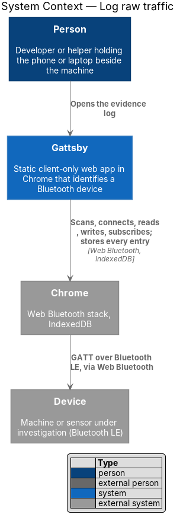
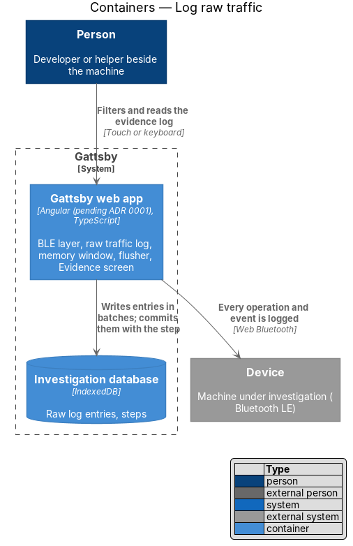
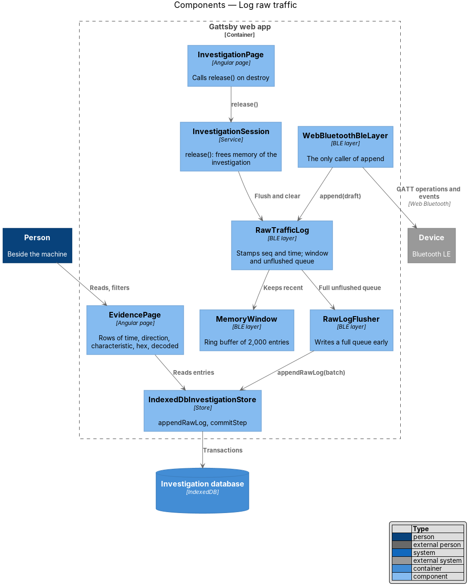
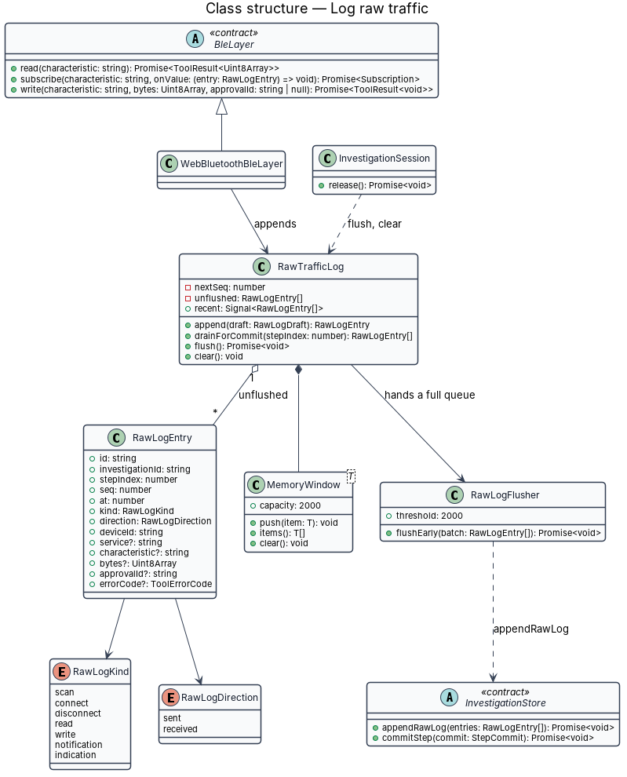
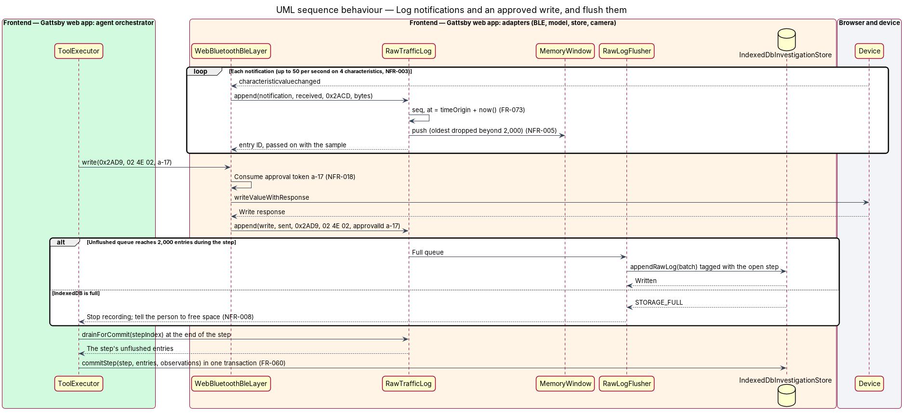
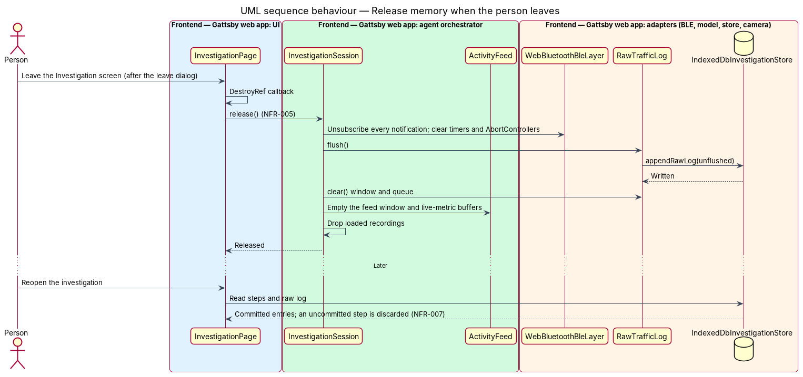

# Log raw traffic

## Overview

Every conclusion Gattsby reaches about a device rests on bytes that crossed the Bluetooth link. This
feature keeps those bytes. The BLE layer appends one raw-log entry for every scan, connect,
disconnect, read, write, notification and indication, each with a high-resolution timestamp, the
characteristic, the direction and the bytes, and every write with the ID of the approval that allowed
it. The log is the evidence that observations, hypotheses and profile entries point to (FR-056), the
proof that no write went out unapproved (NFR-018), and the raw material an exported record carries
(FR-063). Because a device can send hundreds of notifications a second for minutes, the log is also
where memory is most at risk; this feature keeps memory bounded by writing entries to IndexedDB as
they arrive and holding only a window of the most recent entries in memory. It belongs to the
tool-registry subsystem, lives in the BLE layer, and runs whenever a device is in play.

**raw-log entry** — record of one Bluetooth operation or event: its kind, direction, timestamp,
device, service, characteristic, bytes, and, for a write, its approval ID

**direction** — whether the entry went to the device (`sent`) or came from it or from the browser
(`received`)

**high-resolution timestamp** — wall-clock time in milliseconds with a fractional part, taken from
`performance.timeOrigin + performance.now()`

**memory window** — in-memory ring buffer holding the most recent 2,000 raw-log entries

**unflushed entry** — raw-log entry of the open step that is not yet in IndexedDB

The person sees the log on the Evidence screen (`docs/mocks/pages/evidence/default.html`): one row
per entry with its time, an arrow for its direction, the characteristic ("0x1826 / 0x2ACD notify",
"0x2AD9 control point"), the bytes in hex and, where a decoder read them, the decoded values
("Speed 3.00 km/h · distance 8 m · 52 s"). Rows for the person's approvals ("Approved: set target
speed 5.9 km/h") sit directly above the writes they allowed. Filters show only sent or received
traffic (`filtered.html`), and an investigation stopped before any Bluetooth operation says so
(`empty.html`). The Evidence screen itself is designed with the evidence links in
[build the device profile](../../outcome/build-the-device-profile/README.md); this feature supplies
its entries.

## Description

The design introduces these building blocks in the Angular (pending ADR 0001) workspace under
`frontend/src/app/`:

- **`RawLogEntry`** (`ble/raw-log-entry.ts`) — one entry: `id`, `investigationId`, `stepIndex`,
  `seq`, `at`, `kind`, `direction`, `deviceId`, `service?`, `characteristic?`, `bytes?`,
  `approvalId?`, `errorCode?`. `id` is unique within the investigation and derived from `seq`; the
  store keys entries by `[investigationId, seq]`.
- **`RawTrafficLog`** (`ble/raw-traffic-log.ts`) — the log. `append(draft)` stamps the entry with the
  next `seq`, the high-resolution timestamp and the open step's index, puts it in the memory window
  and the unflushed queue, and returns the entry at once, so the BLE layer can hand it to the tool that
  caused it. It refuses a `write` entry without an `approvalId` and records that as a defect (NFR-025),
  because only the approval-gated write path appends writes. `recent()` exposes the window as a
  signal for live views. `drainForCommit(stepIndex)` hands the step's unflushed entries to the step's
  commit (see [save as it runs](../../persistence/save-as-it-runs/README.md)). `clear()` drops the
  window and the queue.
- **`MemoryWindow`** (`ble/memory-window.ts`) — fixed-capacity ring buffer of 2,000 entries (NFR-005).
  Appending to a full window overwrites the oldest entry; nothing is lost, because every entry is
  already queued for IndexedDB or stored.
- **`RawLogFlusher`** (`ble/raw-log-flusher.ts`) — when the unflushed queue reaches the window's
  2,000 entries during a step, for example in a long recording, it writes them early through
  `InvestigationStore.appendRawLog`, still tagged with the open step, off the notification handler.
  The queue therefore never holds more than the window. A flush that fails with `STORAGE_FULL` stops
  recording and tells the person how to free space (NFR-008).
- **`WebBluetoothBleLayer`** (`ble/web-bluetooth-ble-layer.ts`) — the only caller of `append`. It
  logs a `scan` when the chooser opens and its result, a `connect` and every `disconnect` event, each
  `read` with its value, each `write` after the approval token is consumed, with the approval's ID
  (FR-073, criterion 1), and each `notification` or `indication` with its value. A failed operation
  is logged with its error code. Each notification reaches subscribers as its `RawLogEntry`, so a
  recording's values point back to the log (see
  [record a baseline and activity levels](../../proprietary-analysis/record-baseline-and-activity/README.md)).
- **`IndexedDbInvestigationStore`** (`store/indexed-db-investigation-store.ts`) — `appendRawLog`
  writes an early batch tagged with the open step. `commitStep` writes the step's drained entries in
  the same transaction as the step, its envelope and any hypothesis change (FR-060). On reopening,
  entries of a step that never committed are discarded with the step (NFR-007; see save as it
  runs).
- **`InvestigationSession`** (`agent/investigation-session.ts`) — `release()` ends what the
  investigation holds in memory when the person leaves the Investigation screen: it flushes and
  clears `RawTrafficLog`, empties the `ActivityFeed` window and the live-metric buffers, drops loaded
  recordings, and releases notification subscriptions, timers and `AbortController`s (NFR-005).
  `InvestigationPage` calls it from its `DestroyRef` callback.

### Rules

1. Only the BLE layer appends to the log, and it logs every scan, connect, disconnect, read, write,
   notification and indication (FR-073). No tool writes log entries.
2. Each entry's timestamp comes from `performance.timeOrigin + performance.now()`, which has
   sub-millisecond resolution in Chrome (FR-073, criterion 2). `seq` orders entries that share a
   timestamp.
3. Every `write` entry carries the ID of the approval that allowed it (FR-073, NFR-018). Emergency
   stop's writes carry the ID of the person's tap, which is their approval (see
   [emergency stop](../../device-control/emergency-stop/README.md)).
4. Memory holds at most the 2,000 most recent entries plus an unflushed queue of at most the same
   size.
   The model's history is capped by the decision state (FR-041), and a recording longer than 120
   seconds is refused (TOOL-013), which bound the rest of NFR-005.
5. `append` does constant work and formats nothing; hex and decoded text are produced only when an
   entry is shown or exported, so logging keeps up with 50 notifications per second on 4
   characteristics without delaying the UI (NFR-003).
6. Bytes, device names and decoded values are shown as text, never as HTML (NFR-013).
7. Leaving the Investigation screen releases its memory; reopening it reads the log back from the
   store.

### Data shapes

| Type | Fields |
|---|---|
| `RawLogEntry` | `id`, `investigationId`, `stepIndex`, `seq`, `at`, `kind`, `direction`, `deviceId`, `service?`, `characteristic?`, `bytes?`, `approvalId?`, `errorCode?` |
| `RawLogKind` | `scan`, `connect`, `disconnect`, `read`, `write`, `notification`, `indication` |
| `RawLogDirection` | `sent`, `received` |
| `RawLogDraft` | `RawLogEntry` without `id`, `seq`, `at` and `stepIndex`, which `append` fills |

In an export, `bytes` are written as hex (FR-063, NFR-024).

### Errors

| Code | Raised by | Meaning to the person |
|---|---|---|
| `STORAGE_FULL` | `RawLogFlusher` via the store | "Storage is full. Recording has stopped and what was saved is kept. Export and delete old investigations to free space." (NFR-008) |
| `APPROVAL_REQUIRED` | `RawTrafficLog.append` | Never expected; a write reached the log without an approval ID. Recorded as a defect with the tool and stage (NFR-025). |

### Tests that prove it

The acceptance specs use the fake `navigator.bluetooth` (`e2e/fixtures/fake-bluetooth.ts`) and the
`EvidencePage` page object. One approves a command on the FTMS treadmill and checks the exported
record's write entry holds the approval's ID (FR-073, criterion 1). Unit tests check that a logged
notification's timestamp has a fractional millisecond part (criterion 2), that `MemoryWindow` holds
exactly 2,000 entries after 2,500 appends, that `RawLogFlusher` writes early at 2,000 unflushed
entries and `drainForCommit` hands over the rest, and that `append` refuses a write without an approval ID. NFR-005's criterion
is a soak spec in `e2e/soak/`, run only when a person asks because it is too long for CI: the fake
treadmill notifies 20 times a second for 30 minutes of Playwright's fake clock, and the spec samples
the JS heap every simulated minute through the Chrome DevTools Protocol, failing if it grows by more
than 20 MB from minute 5 to minute 30.

## Requirements

The feature realizes the following level-2 (L2) requirements; each refines the level-1 (L1)
requirement cited beside it.

| L2 ID | Refines (L1) | Requirement |
|-------|--------------|-------------|
| [`FR-073`](../../../specs/L2.md#fr-073-log-all-raw-traffic) | `L1-016` | The BLE layer must log every scan, connect, disconnect, read, write, notification and indication with a high-resolution timestamp, the characteristic UUID, the direction and the bytes, and every write with the ID of the approval that allowed it. |
| [`NFR-005`](../../../specs/L2.md#nfr-005-bounded-memory) | `L1-019` | Memory held during an investigation must be bounded: the model's history is capped (FR-041), raw traffic is written to IndexedDB and kept in memory only in a window of the last 2,000 entries, and a recording longer than 120 seconds is refused. Leaving the investigation screen releases its memory. |

## Diagrams

### System context

Every operation Gattsby performs on the device through Chrome, and every value the device sends
back, becomes a raw-log entry stored in the browser.

### Containers

The web app's BLE layer logs each operation and event and writes the entries to the investigation
database in batches; the Evidence screen reads them back.

### Components

`WebBluetoothBleLayer` appends to `RawTrafficLog`, which keeps a `MemoryWindow` and an unflushed
queue that `RawLogFlusher` writes early and the step's commit drains; `InvestigationSession.release()` frees it all when the
person leaves the screen.

### Class structure

`RawTrafficLog` owns the window and the unflushed queue of `RawLogEntry`s; the flusher depends on the
store contract, and only the BLE layer appends.

### Behaviour — log notifications and an approved write, and flush them

Notifications and an approved write are appended with timestamps and, for the write, the approval ID;
a full queue is written early, and the step's commit drains the rest into its transaction.

### Behaviour — release memory when the person leaves

Leaving the Investigation screen writes what is unflushed, clears the window and releases
subscriptions and timers.

