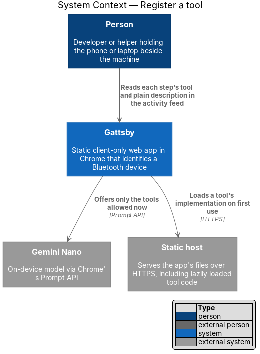
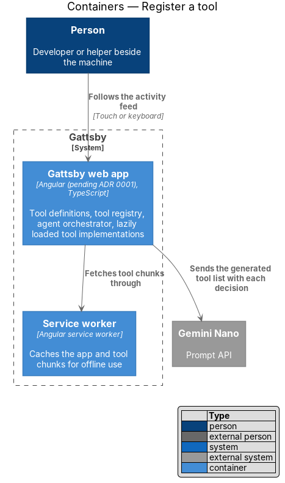
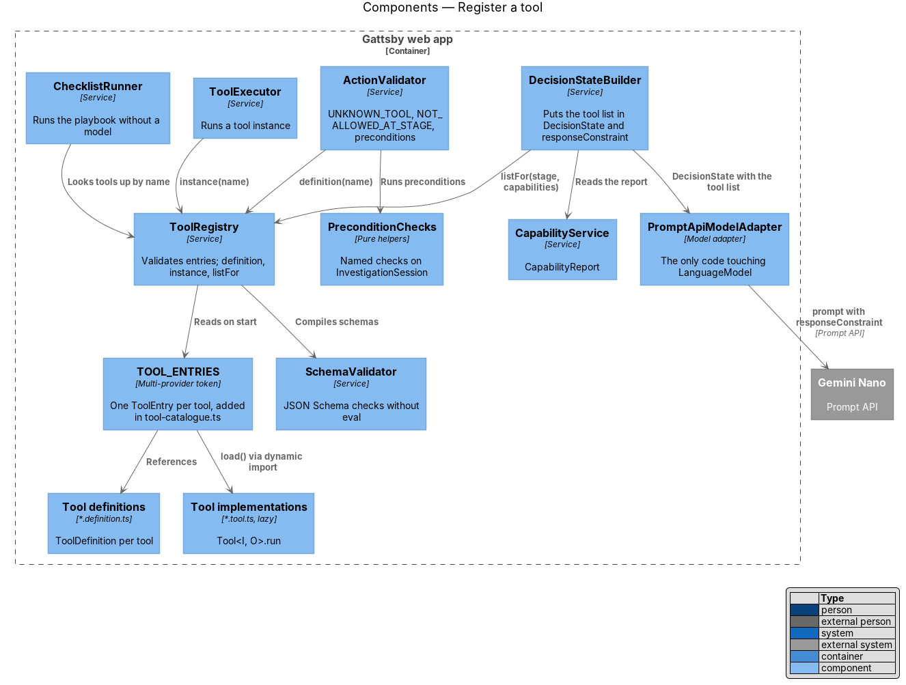
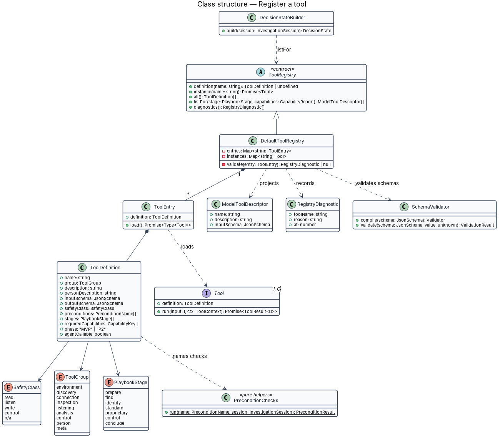
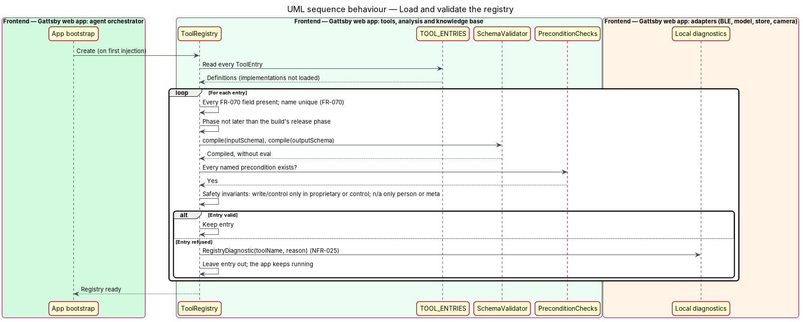
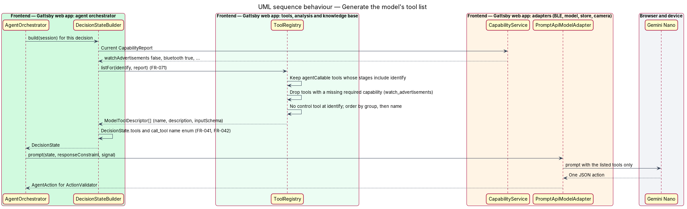

# Register a tool

## Overview

The agent can do only what its tools let it do, and the model can choose only among the tools it is
shown. This feature is the catalogue that makes both true. Every tool is described once, in a typed
registry entry: its name, what it is for, the JSON schemas of its input and output, its safety class,
its preconditions, the playbook stages it may run in, the browser capabilities it needs, and its
phase. Before each model call the orchestrator asks the registry for the tools allowed at the current
stage whose capabilities are available, and gives the model only that list. Because the agent loop
reads tools only through the registry, a new tool needs a registry entry and its implementation, and
nothing in the orchestrator changes. The feature belongs to the tool-registry subsystem and serves
every stage of the playbook, in full agent mode and in checklist mode.

**tool registry** — typed catalogue of every tool the agent or the checklist can run, from which the
model's tool list is generated

**registry entry** — one tool's `ToolDefinition` together with a loader for its implementation

**safety class** — risk category of a tool: `read`, `listen`, `write`, `control`, or `n/a` for person
and meta tools

**precondition** — named check that the investigation's state passes before a tool may run, such as
"connected" or "not emergency-stopped"

**required capability** — browser or platform capability from the capability report that a tool
cannot run without, such as advertisement watching

**model's tool list** — names, descriptions and input schemas of the tools offered to the model for
one decision

The registry has no screen. The person sees its entries in the Investigation screen's activity feed
(`docs/mocks/pages/investigation/identify.html`), where each step shows the tool's name
(`enumerate_gatt`) beside a plain description of what it does ("Connect and list everything it
exposes"). That plain description is part of the registry entry, so the feed and the model describe a
tool from the same source.

## Description

The design introduces these building blocks in the Angular (pending ADR 0001) workspace under
`frontend/src/app/`:

- **`ToolDefinition`** (`tools/tool-definition.ts`) — the registry fields of FR-070: `name`, `group`,
  `description` (for the model), `inputSchema`, `outputSchema`, `safetyClass`, `preconditions`,
  `stages`, `requiredCapabilities` and `phase`. This design adds two: `personDescription`, the plain
  step text the activity feed shows, and `agentCallable`, false only for `emergency_stop`, which runs
  on the person's tap and which the agent may not call (TOOL-024).
- **Definition files** (`tools/<group>/<tool-name>.definition.ts`) — one `ToolDefinition` per tool,
  beside its implementation (`tools/<group>/<tool-name>.tool.ts`). Definitions are small and load
  with the app; implementations load on first use, so analysis tools and the camera stay out of the
  initial bundle (NFR-004).
- **`ToolEntry`** (`tools/tool-entry.ts`) — `{ definition, load }`, where `load` is a dynamic
  `import()` of the implementation's class.
- **`TOOL_ENTRIES`** (`tools/tool-entries.ts`) — multi-provider injection token. Each tool adds itself
  with one line in `tools/tool-catalogue.ts` (`provideTools(...)`); this file and the tool's own two
  files are the only places a new tool touches (NFR-022).
- **`ToolRegistry`** (`tools/tool-registry.ts`) — contract and default implementation. On start it
  reads every `ToolEntry`, validates it (see Rules), and keeps the valid ones. It offers
  `definition(name)`, `instance(name)` (loads and caches the implementation), `all()` and
  `listFor(stage, capabilities)`.
- **`PreconditionChecks`** (`tools/precondition-checks.ts`) — the named checks a definition's
  `preconditions` refer to (`connected`, `notEmergencyStopped`, `controlGranted`, `hasNotifyProperty`
  and so on), each a pure function of `InvestigationSession` that returns a pass or a reason.
  `ActionValidator` runs them (FR-043; see
  [validate and run an action](../../agent/validate-and-run-an-action/README.md)). A new tool that
  needs a new kind of check adds it here, not in the orchestrator.
- **`ModelToolDescriptor`** (`tools/model-tool-descriptor.ts`) — what the model sees for one tool:
  `name`, `description`, `inputSchema`. `listFor` returns these.
- **`SchemaValidator`** (`tools/schema-validator.ts`) — validates values against JSON Schemas for the
  registry, `ActionValidator` and output checks. It shall not use `eval` or `new Function` at run time,
  because the app runs under Trusted Types and a Content Security Policy without `unsafe-eval`
  (NFR-013, NFR-014). The library (for example validators generated at build time) is `<TO SUPPLY>`
  and needs an ADR.
- **`DecisionStateBuilder`** (`agent/decision-state-builder.ts`) — calls
  `ToolRegistry.listFor(session.stage(), capabilityReport)` for every model call and puts the result
  in `DecisionState` and in the `call_tool` action's name enum of the `responseConstraint` (FR-041,
  FR-042; see [decide the next action](../../agent/decide-the-next-action/README.md)).
- **`Playbook`** (`agent/playbook.ts`) — holds the stage order and each stage's checks. A stage's
  allowed tools are not listed in the playbook; they are the tools whose definition names that stage.
  This keeps NFR-022 true: a new tool joins a stage through its own definition.

### Rules

1. `ToolRegistry` refuses an entry that lacks a field of FR-070, repeats a name, has an input or
   output schema that does not compile, names an unknown stage, capability or precondition, or breaks
   a safety invariant:
   - a `write` or `control` tool may list only the `proprietary` and `control` stages;
   - `n/a` is the safety class of the Person and Meta groups only;
   - a tool with `agentCallable` false is never in the model's tool list.
   A refused entry is left out and recorded as a diagnostic with its reason (NFR-025); it never stops
   the app. The unit test on the catalogue fails on any refused entry, so a malformed entry does not
   ship.
2. The build's release phase is configuration (`MVP` or `P2`). A tool whose phase is later than the
   build's is not registered, so a P2 tool never appears in an MVP build's tool list.
3. `listFor(stage, capabilities)` returns, in a stable order (group, then name), every registered tool
   that is `agentCallable`, lists `stage`, and whose every required capability is available in the
   capability report (FR-071). Advertisement watching unavailable means no `watch_advertisements`;
   the Identify stage means no `control` tool.
4. The list is generated for each model call, never cached across steps, because the stage and the
   capabilities can change (for example, Bluetooth turned off).
5. Checklist mode reads the same registry through `ChecklistRunner`, so a tool behaves the same in
   both modes.
6. Adding a protocol or vendor adds knowledge-base data only (FR-066, FR-068), and adding a standard
   profile adds a decoder in `knowledge-base/decoders/`; neither touches `agent/` (NFR-022).

### Data shapes

| Type | Fields |
|---|---|
| `ToolDefinition` | `name`, `group`, `description`, `personDescription`, `inputSchema`, `outputSchema`, `safetyClass`, `preconditions`, `stages`, `requiredCapabilities`, `phase`, `agentCallable` |
| `ToolGroup` | `environment`, `discovery`, `connection`, `inspection`, `listening`, `analysis`, `control`, `person`, `meta` |
| `SafetyClass` | `read`, `listen`, `write`, `control`, `n/a` |
| `CapabilityKey` | `bluetooth`, `promptApi`, `promptApiImage`, `watchAdvertisements`, `requestLEScan`, `getDevices`, `camera`, `persistentStorage` |
| `ToolEntry` | `definition`, `load` |
| `ModelToolDescriptor` | `name`, `description`, `inputSchema` |
| `RegistryDiagnostic` | `toolName`, `reason`, `at` |

`CapabilityKey` names the fields of the `CapabilityReport` built by
[check capabilities](../../environment/check-capabilities/README.md).

### Errors

| Code | Raised by | Meaning to the person |
|---|---|---|
| `UNKNOWN_TOOL` | `ActionValidator`, from `ToolRegistry.definition` | Never shown; the model sees the refusal in its next state. |
| `NOT_ALLOWED_AT_STAGE` | `ActionValidator`, from the definition's `stages` and `agentCallable` | Never shown, except for `emergency_stop`: the person is told the agent asked for a stop (TOOL-024). |
| `UNSUPPORTED` | `ActionValidator`, from `requiredCapabilities` | "This browser can't do that step." A missing-tool request records it (FR-058). |

### Tests that prove it

Unit tests carry this feature, with a fake `CapabilityReport`. One loads the real catalogue and checks
that every MVP tool of the L2 tool specifications is registered with every field of FR-070 and that
no entry is refused (FR-070, criterion 1). Two check `listFor`: with advertisement watching
unavailable, `watch_advertisements` is absent; at the Identify stage, no `control` tool is present
(FR-071). One registers a test-only `read` tool through `TOOL_ENTRIES` and checks it appears in
`listFor` at its stages and runs through `ToolExecutor` (NFR-022, criterion 1). Others feed malformed
entries (missing field, duplicate name, a `control` tool listing Identify) and check each is refused
with a diagnostic. The behaviour specs exercise the generated list through the fake `LanguageModel`
(`e2e/fixtures/fake-language-model.ts`), which fails a spec when a scripted action names a tool that
was not in the list it received.

## Requirements

The feature realizes the following level-2 (L2) requirements; each refines the level-1 (L1)
requirement cited beside it.

| L2 ID | Refines (L1) | Requirement |
|-------|--------------|-------------|
| [`FR-070`](../../../specs/L2.md#fr-070-describe-every-tool-in-the-registry) | `L1-016` | Each tool must be registered with: name, group, description for the model, JSON input schema, output schema, safety class (`read`, `listen`, `write`, `control`, or `n/a` for person and meta tools), preconditions, playbook stages it is allowed in, required capabilities, and phase. |
| [`FR-071`](../../../specs/L2.md#fr-071-generate-the-models-tool-list) | `L1-016` | For each model call, the orchestrator must generate the tool list from the registry, holding only the tools allowed at the current stage whose required capabilities are available. |
| [`NFR-022`](../../../specs/L2.md#nfr-022-extend-without-changing-the-loop) | `L1-022` | Adding a tool must need only a registry entry and its implementation; adding a protocol or vendor must need only knowledge-base data (and, for a new standard profile, a decoder). Neither may change the orchestrator. |

## Diagrams

### System context

The registry decides which tools Gemini Nano is offered at each decision; the person sees each tool's
plain description in the activity feed.

### Containers

Everything in this feature lives in the web app; tool definitions ship with it and tool
implementations load on first use from the same static host.

### Components

`ToolRegistry` collects `ToolEntry`s from `TOOL_ENTRIES` and validates them with `SchemaValidator`;
`DecisionStateBuilder` asks it for the list for the current stage and capabilities, and
`ActionValidator` and `ToolExecutor` look tools up by name.

### Class structure

A `ToolEntry` pairs a `ToolDefinition` with a loader for its `Tool` implementation; the registry owns
the entries and projects them to `ModelToolDescriptor`s.

### Behaviour — load and validate the registry

On start, the registry reads each entry, validates its fields, schemas and safety invariants, keeps
the valid ones and records a diagnostic for each refused one.

### Behaviour — generate the model's tool list

For each model call, `DecisionStateBuilder` asks for the tools at the current stage, and the registry
filters out tools that are not agent-callable or whose capabilities are missing.

