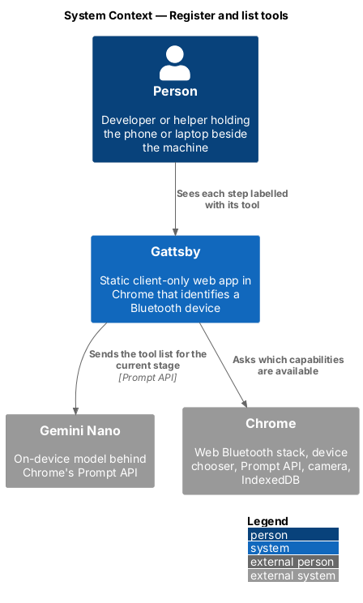
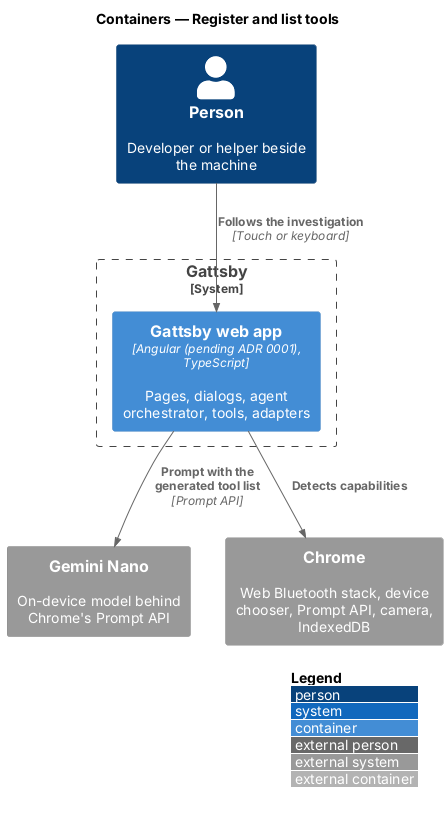
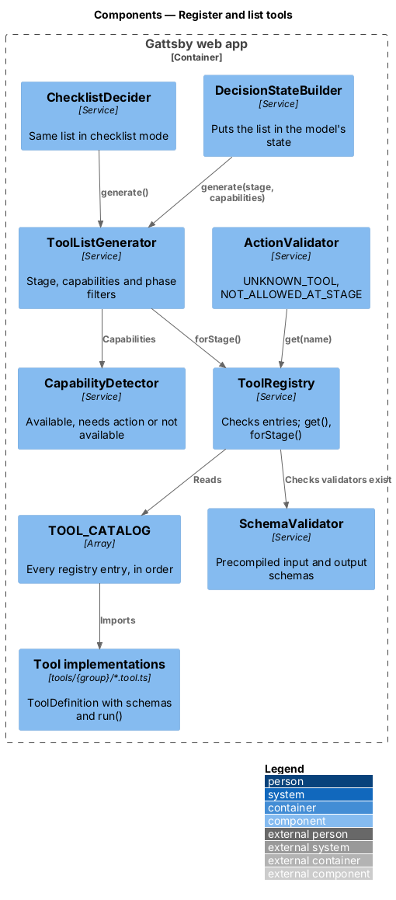
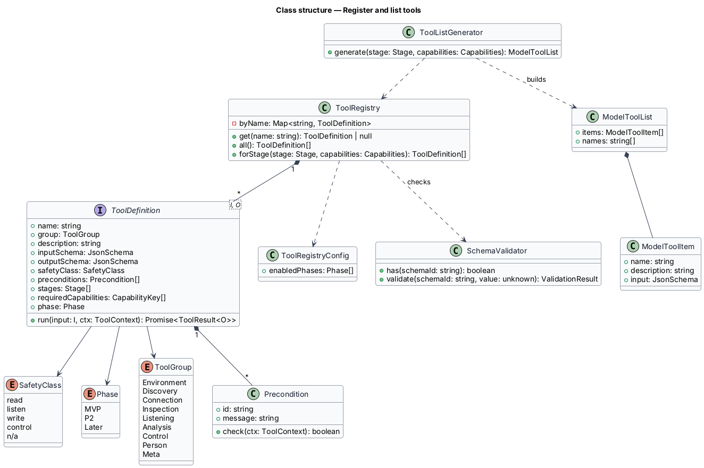
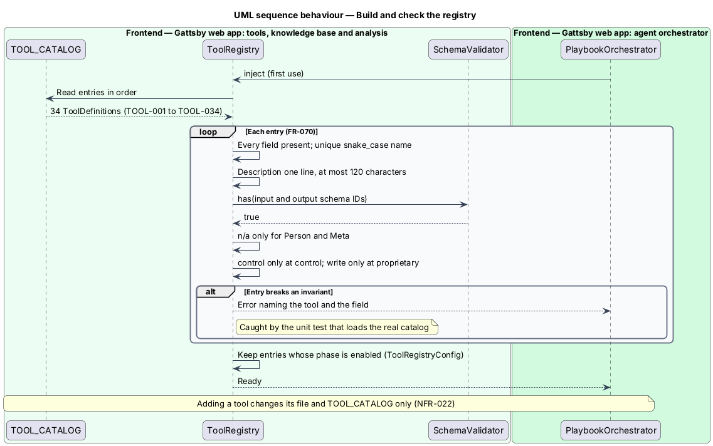
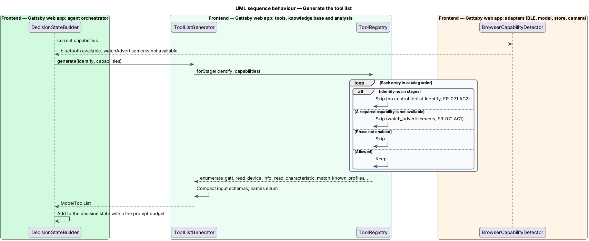

# Register and list tools

## Overview

The agent acts only through tools: pre-written functions that scan, connect, read, listen, analyse,
ask the person, or record a conclusion. This feature defines how a tool is described once, in the
tool registry, and how the orchestrator derives from that description the short list of tools the
model may choose from at each step. It belongs to the tool-registry subsystem and runs before every
model call, at every stage of the playbook.

**tool** — one entry in the tool registry: a named, schema-described function with a safety class,
preconditions, allowed stages, required capabilities and a phase

**registry entry** — the `ToolDefinition` object a tool exports and the one line that adds it to
the catalog

**tool list** — the subset of the registry the model sees for one decision: the tools allowed at
the current stage whose required capabilities are available

**phase** — the delivery phase of a tool (`MVP`, `P2` or `Later`); a build includes only the phases
it enables

The person never sees the registry, but sees its names: the activity feed labels each step with the
tool's name and a plain description ("`enumerate_gatt` Connect and list everything it exposes",
`docs/mocks/pages/investigation/identify.html`), the names the mocks took from the registry
(`docs/mocks/README.md`, departures table).

The registry is the single source of truth for what a tool is and where it may run. The playbook,
the validator, the checklist and the model's list all read it, so adding a tool needs only its file
and its registry entry, and no change to the orchestrator (NFR-022).

## Description

The design introduces these building blocks in the Angular (pending ADR 0001) workspace under
`frontend/src/app/`:

- **`ToolDefinition<I, O>`** (`tools/tool-definition.ts`) — `name` (snake case), `group`,
  `description` (one line for the model), `inputSchema`, `outputSchema`, `safetyClass` (`read`,
  `listen`, `write`, `control`, `n/a`), `preconditions`, `stages`, `requiredCapabilities`, `phase`
  and `run(input, ctx)` (FR-070).
- **Tool implementations** (`tools/{group}/{tool-name}.tool.ts`) — one file per tool, for example
  `tools/discovery/scan-devices.tool.ts` exporting `scanDevicesTool`. Its schemas sit beside it as
  `{tool-name}.input.schema.json` and `{tool-name}.output.schema.json`.
- **`TOOL_CATALOG`** (`tools/tool-catalog.ts`) — the ordered, read-only array of every registry
  entry. Adding a tool adds one import and one array element here.
- **`ToolRegistry`** (`tools/tool-registry.ts`) — built from `TOOL_CATALOG` and
  `ToolRegistryConfig`. `get(name)`, `all()`, and `forStage(stage, capabilities)`. It checks every
  entry when it is created (see "Registry invariants").
- **`ToolRegistryConfig`** (`tools/tool-registry-config.ts`) — `enabledPhases`, `['MVP']` in a
  production build until P2 ships.
- **`ToolListGenerator`** (`tools/tool-list-generator.ts`) — `generate(stage, capabilities)` returns
  the `ModelToolList`: for each allowed tool, its name, description and a compact form of its input
  schema, in catalog order (FR-071). It also yields the enum of tool names that the response
  constraint of `call_tool` uses (see the ask-the-model design).
- **`SchemaValidator`** (`tools/schema-validator.ts`) — holds validators precompiled at build time
  by `frontend/scripts/compile-schemas.ts` from every `*.schema.json` under `tools/` and
  `frontend/src/schemas/`; no `eval` or `new Function` at run time (NFR-013).
- **`CapabilityDetector`** (`environment/capability-detector.ts`) — supplies `Capabilities`; a
  capability counts as available only when its status is *Available* (see the check-capabilities
  design).
- **Consumers** — `DecisionStateBuilder` puts the tool list in the model's state (see the
  build-the-decision-state design); `ActionValidator` refuses an unknown name with `UNKNOWN_TOOL`
  and a tool outside the list with `NOT_ALLOWED_AT_STAGE` (see the validate-every-action design);
  `Playbook` and `ChecklistDecider` read `forStage` instead of keeping lists of their own.

### Registry invariants

`ToolRegistry` refuses to start, with an error naming the tool and the field, when any entry breaks
one of these. A unit test loads the real catalog, so a broken entry fails the local test run and the
build's acceptance path, never a person's investigation.

1. Every field of FR-070 is present; `name` is unique and matches `^[a-z][a-z0-9_]*$`.
2. `description` is one line of at most 120 characters, so the list stays within the model's prompt
   budget (NFR-020; the limit is a proposal).
3. `inputSchema` and `outputSchema` each have a precompiled validator.
4. `safetyClass` `n/a` belongs only to the groups `Person` and `Meta`.
5. A `control` tool lists only the stage `control`; a `write` tool lists only the stage
   `proprietary` (`replay_known_handshake`). `emergency_stop` lists only `control` for the model;
   `EmergencyStopController` runs it directly at any stage (see the emergency-stop design).
6. Every name in `requiredCapabilities` is a key of `Capabilities`.

### Generating the tool list

For each model call, `ToolListGenerator.generate(stage, capabilities)` keeps the tools that pass all
three filters, in catalog order:

1. `stages` includes the current stage (FR-071 AC2: at `identify` no `control` tool passes).
2. Every required capability is *Available* (FR-071 AC1: with advertisement watching unavailable,
   `watch_advertisements` is absent).
3. `phase` is in `ToolRegistryConfig.enabledPhases`.

Each list item is `{ name, description, input }`, where `input` is the input schema without
`$schema`, titles and examples. The same filters give the checklist its tools, so both modes see the
same registry.

### Catalog at MVP

| Group | Tools (MVP) | Tools (P2) |
|---|---|---|
| Environment | `check_capabilities` | — |
| Discovery | `scan_devices`, `scan_all_devices`, `power_cycle_match` | `watch_advertisements`, `get_permitted_devices` |
| Connection | `connect`, `reconnect`, `disconnect` | — |
| Inspection | `enumerate_gatt`, `read_device_info`, `read_characteristic`, `match_known_profiles`, `read_supported_ranges` | — |
| Listening | `subscribe_and_record`, `baseline_vs_activity` | — |
| Analysis | `decode_standard`, `find_varying_bytes`, `vendor_signature_lookup`, `assess_reachability` | `correlate_with_action`, `guess_field_encoding`, `detect_framing` |
| Control | `request_control`, `send_command`, `emergency_stop` | `replay_known_handshake` |
| Person | `ask_user`, `request_action` | `capture_photo`, `compare_with_console` |
| Meta | `update_hypothesis`, `request_missing_tool`, `finish` | — |

Each tool's stages, preconditions and capabilities belong to its own design.

### Adding a tool

1. Write `tools/{group}/{tool-name}.tool.ts` with its two schema files.
2. Add the entry to `TOOL_CATALOG`.
3. Build: `compile-schemas.ts` precompiles the schemas, and the registry checks the entry.

The orchestrator, the validator and the playbook do not change (NFR-022). That the orchestrator's
source stays unchanged is a review check, not a test: the repository writes no architecture tests.

### Data shapes

| Type | Fields |
|---|---|
| `ToolDefinition<I, O>` | `name`, `group`, `description`, `inputSchema`, `outputSchema`, `safetyClass`, `preconditions: Precondition[]`, `stages: Stage[]`, `requiredCapabilities: CapabilityKey[]`, `phase`, `run(input: I, ctx: ToolContext): Promise<ToolResult<O>>` |
| `Precondition` | `id` (for example `connected`, `controlGranted`), `check(ctx): boolean`, `message` |
| `ModelToolList` | `items: { name, description, input }[]`, `names: string[]` |

### Tests that prove it

A unit test loads the registry and checks that every MVP tool of L2 section 3 is present with every
FR-070 field. Unit tests of `ToolListGenerator` check that `watch_advertisements` is absent when
advertisement watching is unavailable, that no `control` tool is listed at `identify`, and that a
fixture `read` tool added through a test catalog appears at its stages. An acceptance spec checks
the tool names the fake `LanguageModel` receives at Identify.

### Built in journey 2

`ToolDefinition`, `TOOL_CATALOG` and `ToolRegistry` are built with the invariants above and a `labels` field (follow-the-investigation design). The thirteen tools journey 2 needs are registered. Not built yet: `compile-schemas.ts`, the precompiled `SchemaValidator` and `ToolListGenerator`, which first matter when untrusted model actions arrive (journey 6). Until then each tool checks its own input limits, as `ask_user` and `request_action` do.

## Requirements

The feature realizes the following level-2 (L2) requirements; each refines the level-1 (L1)
requirement cited beside it.

| L2 ID | Refines (L1) | Requirement |
|-------|--------------|-------------|
| [`FR-070`](../../../specs/L2.md#fr-070-describe-every-tool-in-the-registry) | `L1-016` | Each tool must be registered with: name, group, description for the model, JSON input schema, output schema, safety class (`read`, `listen`, `write`, `control`, or `n/a` for person and meta tools), preconditions, playbook stages it is allowed in, required capabilities, and phase. |
| [`FR-071`](../../../specs/L2.md#fr-071-generate-the-models-tool-list) | `L1-016` | For each model call, the orchestrator must generate the tool list from the registry, holding only the tools allowed at the current stage whose required capabilities are available. |
| [`NFR-022`](../../../specs/L2.md#nfr-022-extend-without-changing-the-loop) | `L1-022` | Adding a tool must need only a registry entry and its implementation; adding a protocol or vendor must need only knowledge-base data (and, for a new standard profile, a decoder). Neither may change the orchestrator. |

## Diagrams

### System context

Gattsby hands Gemini Nano a tool list for each decision, built from its registry and from what
Chrome reports as available.

### Containers

The registry and the generator live in the web app; the model receives the list through the Prompt
API.

### Components

`ToolRegistry` is built from `TOOL_CATALOG` and checked against `SchemaValidator`; `ToolListGenerator`
filters it by stage, capabilities and phase for `DecisionStateBuilder`, `ActionValidator` and the
checklist.

### Class structure

`ToolRegistry` owns the `ToolDefinition`s; `ToolListGenerator` reads it with `Capabilities` and
`ToolRegistryConfig` to produce a `ModelToolList`.

### Behaviour — build and check the registry

At start the registry reads the catalog and checks each entry's fields, schemas, safety class and
stages; a broken entry stops it with the tool and field named.

### Behaviour — generate the tool list

Before a model call the generator keeps the tools allowed at the stage whose capabilities are
available and whose phase is enabled.

