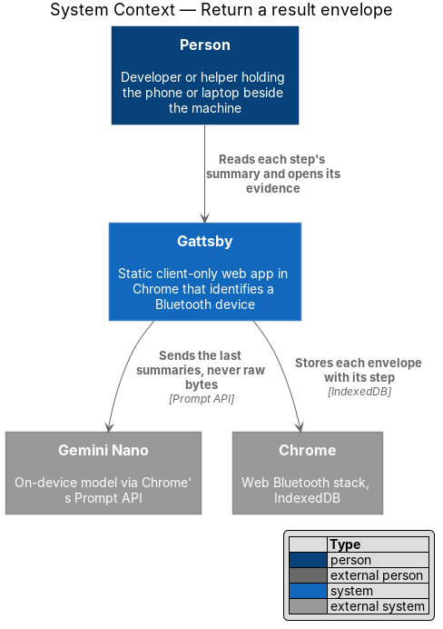
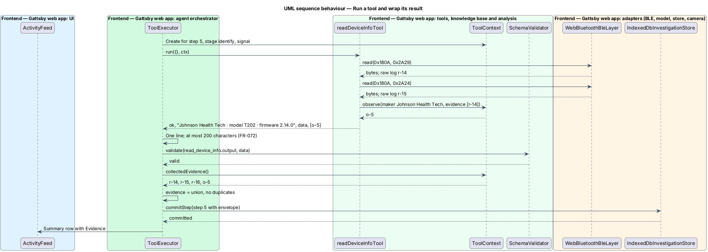
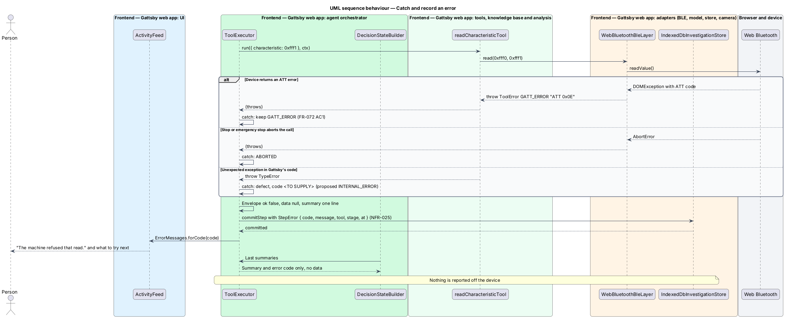

# Return a result envelope

## Overview

Every tool, from `scan_devices` to `finish`, answers the orchestrator in the same shape: whether it
worked, one line saying what happened, its data, its error, and the evidence it created. This feature
defines that result envelope, guarantees that no exception escapes a tool to the orchestrator, and
records every error locally with its code, tool, stage and time, while the person sees a plain
message that says what to do next. It belongs to the tool-registry subsystem and runs at every step
of every stage.

**result envelope** — the object `{ ok, summary, data, error, evidence }` that every tool returns

**shared error code** — one of the codes in L2 section 3 ("Shared error codes") that every tool,
screen and test branches on

**summary** — one plain-text line of at most 200 characters, for the model's state and the
person's activity feed (FR-044)

**evidence** — IDs of the raw log entries and observations a tool call created

The envelope surfaces on the Investigation page: each step in the activity feed shows the tool's
summary ("Connected. 4 services, 3 of them standard.", `docs/mocks/pages/investigation/identify.html`),
and a failed step shows its plain message. The Evidence page shows the tool calls with their
evidence (`docs/mocks/pages/evidence/default.html`). Nothing is reported off the device (NFR-025,
NFR-012).

A small model reasons best over short, uniform results, and the orchestrator can only stay
deterministic if a failing tool cannot crash it. The envelope gives both: the model reads the
summary and the code, the store keeps the full data, and every failure becomes data.

## Description

The design introduces these building blocks in the Angular (pending ADR 0001) workspace under
`frontend/src/app/`:

- **`ToolResult<O>`** (`tools/tool-result.ts`) — the envelope as a union on `ok`:
  `{ ok: true, summary, data: O, error: null, evidence }` or
  `{ ok: false, summary, data: null, error: ToolError, evidence }`. Helpers `ToolResult.ok(...)`
  and `ToolResult.fail(...)` build them.
- **`ToolError`** (`tools/tool-error.ts`) and **`ErrorCode`** (`tools/error-code.ts`) —
  `{ code: ErrorCode, message: string }`; `ErrorCode` is the string union of the shared codes. A
  tool, the BLE layer or the store may throw a `ToolError`; the executor turns it into an envelope.
- **`ToolContext`** (`tools/tool-context.ts`) — gives a tool `ble`, `kb`, `store`, `prompts`,
  `investigationId`, `stage` and `signal`, plus `observe(observation)`, which assigns an `o-` ID.
  Each BLE operation returns the `r-` IDs of the raw log entries it appended. The context collects
  every ID it hands out during the call.
- **`ToolExecutor`** (`agent/tool-executor.ts`) — runs `tool.run(input, ctx)` inside `try`/`catch`,
  maps any throw to an envelope, normalises the envelope (see "Rules"), validates `data` against the
  tool's output schema, records an error on the step, and commits the step (see the
  save-as-the-investigation-runs design).
- **`WebBluetoothBleLayer`** (`ble/web-bluetooth-ble-layer.ts`) — the only code that maps
  Web Bluetooth `DOMException`s to shared codes (table below), so tools never inspect browser
  errors.
- **`SchemaValidator`** (`tools/schema-validator.ts`) — validates `data` against the tool's
  precompiled output schema before it is stored.
- **`ErrorMessages`** (`tools/error-messages.ts`) — maps each shared code to the plain message and
  next step the person sees. Strings are provisional (A-01).
- **`ActivityFeed`** (`ui/activity-feed/activity-feed.component.ts`) — renders the summary, or the
  plain message and next step for a failed step, as text (NFR-013).
- **`DecisionStateBuilder`** (`agent/decision-state-builder.ts`) — gives the model the summary and,
  when `ok` is false, the error code; never `data` (see the build-the-decision-state design).

### Rules the executor enforces

1. No exception escapes `ToolExecutor.execute`. A thrown `ToolError` keeps its code; a
   `StoreError` with `STORAGE_FULL` becomes `STORAGE_FULL`; an `AbortError` becomes `ABORTED`; a
   `TimeoutError` becomes `TIMEOUT` (FR-072 AC1).
2. Any other throw is a defect. The shared codes hold no code for a defect, so the design proposes
   adding `INTERNAL_ERROR` ("An unexpected error in Gattsby's own code") to L2 section 3; until that
   is decided, a defect maps to `GATT_ERROR` when it came from the BLE layer and otherwise ends the
   loop with the stop reason `failure` (see the end-the-loop design), recorded with its tool and
   stage (journey 2). The step records the exception's name
   and message, never its stack in the model's state.
3. `summary` is plain text on one line. Line breaks become spaces, and a summary longer than 200
   characters is cut to 199 characters plus "…".
4. When `ok` is true, `data` shall validate against the tool's output schema before it is stored. A
   failure is a defect (rule 2), and the envelope becomes `ok: false`.
5. When `ok` is false, `data` is `null` and `error.code` is a shared code.
6. `evidence` is the union of the IDs the tool returned and the IDs the context handed out during
   the call, without duplicates. An ID the tool returns that the context did not hand out and that
   does not resolve is dropped and recorded as a defect.
7. Every failed step records `{ code, message, tool, stage, at }` in its `steps` row (NFR-025), and
   the record export carries it.
8. A refused action (from `ActionValidator`) records the same shape with the action's tool, so
   `UNKNOWN_TOOL`, `INVALID_INPUT`, `NOT_ALLOWED_AT_STAGE` and `PRECONDITION_FAILED` are recorded
   like tool errors.
9. Nothing is sent anywhere: no telemetry, no error-reporting service, no remote log (NFR-025).

### Web Bluetooth exceptions

| `DOMException` name | Context | Shared code |
|---|---|---|
| `NotFoundError` | `requestDevice` chooser closed | `USER_CANCELLED` |
| `NotFoundError` | service or characteristic absent | `PROPERTY_MISSING` |
| `SecurityError` | service not in `optionalServices` | `SERVICE_NOT_PERMITTED` |
| `SecurityError` | UUID on the blocklist | `BLOCKLISTED` |
| `NetworkError` | connect fails | `CONNECTION_FAILED` |
| `NetworkError` | GATT server disconnected | `NOT_CONNECTED` |
| `NotSupportedError` | operation not supported by the characteristic | `PROPERTY_MISSING` |
| `NotSupportedError` | API absent on this platform | `UNSUPPORTED` |
| `InvalidStateError`, `NotAllowedError` | Bluetooth off or blocked by policy | `BLE_UNAVAILABLE` |
| `NotAllowedError` | insufficient authentication or encryption | `AUTH_REQUIRED` |
| Any ATT error returned by the device | read, write or notify | `GATT_ERROR` (ATT code in the message) |

The context column is decided from the call the BLE layer was making and, where Chrome gives one,
the exception's message. Messages Chrome uses differ by platform, so the exact matching is
`<TO SUPPLY>` and is covered by the fake Bluetooth fixture's scripted errors.

### What the person sees

`ErrorMessages` gives each code a plain message and a next step. Examples (provisional, A-01; no
mock shows a failed tool step):

| Code | Message | Next step |
|---|---|---|
| `GATT_ERROR` | "The machine refused that read." | "Gattsby will try another way. If it keeps happening, switch the machine off and on." |
| `NOT_CONNECTED` | "The connection dropped." | "Stay close to the machine; Gattsby is reconnecting." |
| `TIMEOUT` | "That took too long." | "Check the machine is still on, then carry on." |
| `STORAGE_FULL` | "Storage is full." | "Export old investigations, then delete them." |

### Data shapes

| Type | Fields |
|---|---|
| `ToolResult<O>` | `ok`, `summary`, `data: O \| null`, `error: ToolError \| null`, `evidence: string[]` |
| `ToolError` | `code: ErrorCode`, `message` |
| `StepError` | `code`, `message`, `tool`, `stage`, `at` |

### Tests that prove it

Unit tests run `ToolExecutor` with fake tools that return, throw a `ToolError`, throw a plain
`Error`, exceed 200 characters and return data that fails their output schema, and check each
envelope. An acceptance spec scripts a GATT read error in the fake Bluetooth fixture and checks that
the record holds the code, tool and stage and that the person sees a message saying what to try
(NFR-025 AC1). The fixture fails any spec with a page error.

## Requirements

The feature realizes the following level-2 (L2) requirements; each refines the level-1 (L1)
requirement cited beside it.

| L2 ID | Refines (L1) | Requirement |
|-------|--------------|-------------|
| [`FR-072`](../../../specs/L2.md#fr-072-return-a-common-result-envelope) | `L1-016` | Every tool must return `{ ok, summary, data, error, evidence }`: `ok` a boolean; `summary` a line of at most 200 characters; `data` matching the tool's output schema when `ok`; `error` with a `code` from the shared error codes (section 3) and a plain message when not `ok`; `evidence` the IDs of the raw log entries and observations it created. |
| [`NFR-025`](../../../specs/L2.md#nfr-025-local-diagnostics-without-telemetry) | `L1-022` | Errors must be recorded with their error code, tool, stage and timestamp in the investigation record, and shown to the person as a plain message with what to do next. Nothing is reported remotely. |

## Diagrams

### System context

Tools reach the device and the browser through Gattsby's adapters; every outcome, success or error,
comes back as one envelope and stays on the device.

### Containers

The web app wraps every tool call in an envelope, sends the model only its summary and code, and
records the full envelope and any error in the investigation database.

### Components

`ToolExecutor` runs the tool with a `ToolContext`, maps throws from the BLE layer and the store,
validates the data, and hands the summary and message to the feed and the decision state.

### Class structure

`ToolResult` is a union on `ok` that carries a `ToolError` of one `ErrorCode` when it fails;
`ToolExecutor` builds a `StepError` from it for the record.

### Behaviour — run a tool and wrap its result

`read_device_info` reads through the BLE layer, records an observation, and returns an envelope that
the executor normalises, validates and commits.

### Behaviour — catch and record an error

A GATT error, an abort or an unexpected exception each becomes an `ok: false` envelope with a shared
code, recorded with tool, stage and time, and shown as a plain message.

