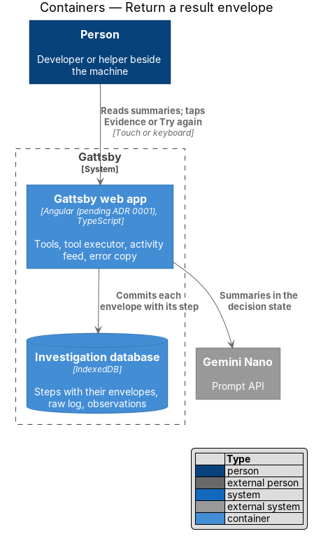
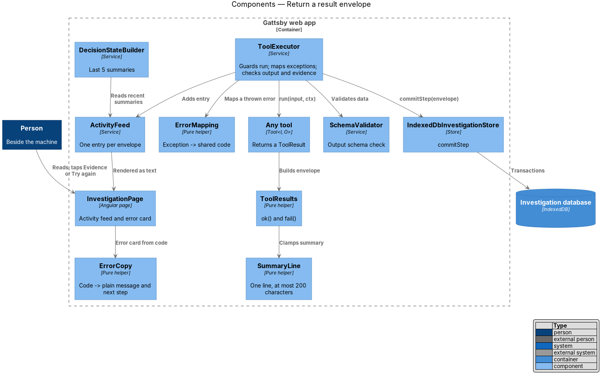
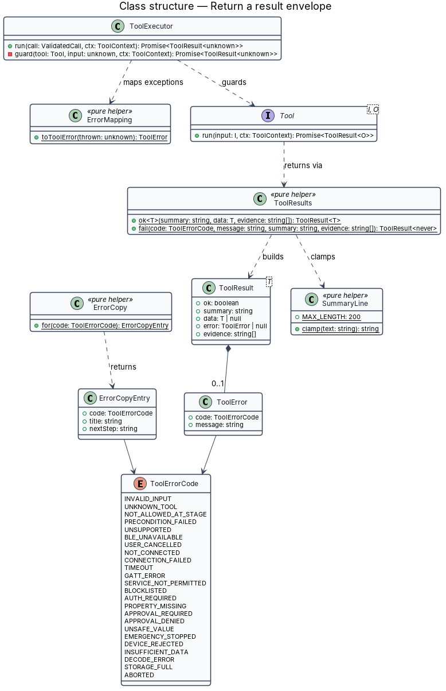
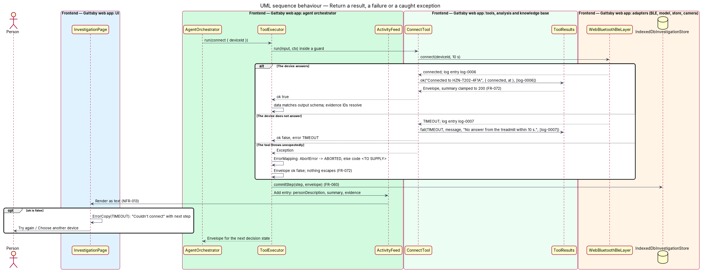

# Return a result envelope

## Overview

The orchestrator runs more than thirty tools that scan, connect, read, record, analyse, ask the
person and write to devices. It can treat them all alike only if they all answer alike. This feature
is that common answer: every tool returns the same result envelope, `{ ok, summary, data, error,
evidence }`. `ok` says whether it worked; `summary` is the one line the model's state and the
person's activity feed show; `data` is the full output, checked against the tool's output schema;
`error` carries a shared error code and a plain message when the tool failed; `evidence` lists the
raw-log entries and observations the call created, so every claim can be traced to the bytes behind
it. A failing tool returns an envelope, never an exception. The feature belongs to the tool-registry
subsystem and applies to every tool call, in full agent mode and in checklist mode.

**result envelope** — uniform record a tool returns for one call: `ok`, `summary`, `data`, `error`,
`evidence`

**summary** — single line of at most 200 characters, written by deterministic code, that states what
the call found or why it failed

**shared error code** — one of the codes listed in the L2 tool specifications (section 3), on which
screens and the orchestrator branch

**evidence ID** — identifier of a raw-log entry or an observation created by the call

The person sees envelopes in the Investigation screen's activity feed
(`docs/mocks/pages/investigation/identify.html`): each step shows its tool, its summary ("Connected.
4 services, 3 of them standard."), the observations it produced with their status, and an "Evidence"
link. A failed step (`docs/mocks/pages/investigation/error.html`) shows the summary of the failure
("No answer from the treadmill within 10 s."), and the screen turns the error code into a plain card
with what to do next ("Couldn't connect. Wake the console, stand within 2 metres of it, then try
again.") and the actions "Try again" and "Choose another device".

## Description

The design introduces these building blocks in the Angular (pending ADR 0001) workspace under
`frontend/src/app/`:

- **`ToolResult<T>`** (`tools/tool-result.ts`) — the envelope type: `ok`, `summary`, `data` (`T` when
  `ok`, `null` otherwise), `error` (`ToolError` when not `ok`, `null` otherwise), `evidence`.
- **`ToolError`** (`tools/tool-error.ts`) — `code: ToolErrorCode` and `message`, a plain sentence for
  the record and the model.
- **`ToolErrorCode`** (`tools/tool-error-code.ts`) — the union of the shared error codes of the L2
  tool specifications, and nothing else.
- **`ToolResults`** (`tools/tool-results.ts`) — the only way tools build envelopes:
  `ok(summary, data, evidence)` and `fail(code, message, summary, evidence)`. Both pass the summary
  through `SummaryLine`.
- **`SummaryLine`** (`tools/summary-line.ts`) — pure helper. Collapses line breaks and runs of
  whitespace to one space, strips control characters, and truncates at 200 characters with an
  ellipsis as the last character (FR-044). It never adds payload hex: summaries name counts, offsets,
  decoded values and knowledge-base names (FR-041).
- **`ToolExecutor`** (`agent/tool-executor.ts`) — runs a tool inside a guard. A tool that throws or
  rejects does not reach the orchestrator: the executor maps the exception with `ErrorMapping` and
  returns a failing envelope (FR-072, criterion 1). On `ok`, it checks `data` against the tool's
  output schema with `SchemaValidator` before the result is stored. It checks that every evidence ID
  resolves to an entry or observation of this investigation. It then hands the envelope to
  `InvestigationStore.commitStep` with the step (FR-060).
- **`ErrorMapping`** (`agent/error-mapping.ts`) — pure helper that maps what a tool may throw to a
  shared code: an `AbortError` to `ABORTED`, a `QuotaExceededError` to `STORAGE_FULL`, a timeout to
  `TIMEOUT`. Browser errors from Web Bluetooth are already mapped inside the BLE layer, which returns
  codes such as `NOT_CONNECTED`, `GATT_ERROR` or `AUTH_REQUIRED` and never throws. An exception that
  matches nothing is a defect in Gattsby; the shared codes hold no code for it, so its code is
  `<TO SUPPLY>` (this design proposes adding `INTERNAL_ERROR` to section 3). The same gap covers
  `data` that fails its output schema.
- **`ErrorCopy`** (`ui/error-copy.ts`) — maps each `ToolErrorCode` to the plain message and next step
  a screen shows, so the person never sees a raw code or exception text (NFR-025). Screens branch on
  the code; the copy is provisional until the Behavior Description is added (A-01).
- **`ActivityFeed`** (`agent/activity-feed.ts`) — adds one `ActivityEntry` per envelope with the
  tool's `personDescription`, the summary and the evidence IDs, rendered as text (NFR-013; see
  [show agent activity](../../agent/show-agent-activity/README.md)).

### Rules

1. Every tool returns a `ToolResult`. A tool's `run` shall not throw on an expected failure; it
   returns `ToolResults.fail` with a shared code.
2. `ok` true means `data` matches the output schema and `error` is `null`. `ok` false means `error`
   holds a shared code and a message, and `data` is `null`.
3. `summary` is always present, including on failure, and is at most 200 characters on one line.
4. `evidence` lists only IDs the call itself created: raw-log entries written by the BLE layer during
   the call, and observations recorded by the tool. A pure analysis tool lists the observations it
   recorded and may list the recordings it read.
5. Device names, characteristic values and model text that appear in a summary or message are data.
   Screens render them as text, never as HTML (NFR-013).
6. Refusals before a tool runs (`UNKNOWN_TOOL`, `INVALID_INPUT`, `NOT_ALLOWED_AT_STAGE`,
   `PRECONDITION_FAILED`, `APPROVAL_DENIED`) use the same envelope, so the model reads every outcome
   the same way and each counts as a step (FR-043).
7. Each failing envelope is recorded with its code, tool, stage and timestamp (NFR-025; see
   [record local diagnostics](../../platform/record-local-diagnostics/README.md)).

### Data shapes

| Type | Fields |
|---|---|
| `ToolResult<T>` | `ok`, `summary`, `data` (`T` or `null`), `error` (`ToolError` or `null`), `evidence` (string IDs) |
| `ToolError` | `code` (`ToolErrorCode`), `message` |
| `ToolErrorCode` | `INVALID_INPUT`, `UNKNOWN_TOOL`, `NOT_ALLOWED_AT_STAGE`, `PRECONDITION_FAILED`, `UNSUPPORTED`, `BLE_UNAVAILABLE`, `USER_CANCELLED`, `NOT_CONNECTED`, `CONNECTION_FAILED`, `TIMEOUT`, `GATT_ERROR`, `SERVICE_NOT_PERMITTED`, `BLOCKLISTED`, `AUTH_REQUIRED`, `PROPERTY_MISSING`, `APPROVAL_REQUIRED`, `APPROVAL_DENIED`, `UNSAFE_VALUE`, `EMERGENCY_STOPPED`, `DEVICE_REJECTED`, `INSUFFICIENT_DATA`, `DECODE_ERROR`, `STORAGE_FULL`, `ABORTED` |
| `ErrorCopyEntry` | `code`, `title`, `nextStep` |

Example of a failing envelope, as the error mock shows it:

```json
{
  "ok": false,
  "summary": "No answer from the treadmill within 10 s.",
  "data": null,
  "error": { "code": "TIMEOUT", "message": "GATT connect did not complete within 10 s." },
  "evidence": ["log-0007"]
}
```

### Errors

The envelope carries every shared code; this feature raises none of its own. The open gap is the
code for an unexpected exception or for output that fails its schema (`<TO SUPPLY>`, see
`ErrorMapping`).

### Tests that prove it

Unit tests cover `SummaryLine` (a 250-character summary becomes 200 characters ending in an ellipsis;
a line break becomes a space), `ToolExecutor` with a fake tool that throws, one that rejects with an
`AbortError`, and one whose `data` fails its output schema, checking each returns an envelope with
`ok` false and a shared code and that nothing is thrown (FR-072, criterion 1). The acceptance spec
uses the fake `navigator.bluetooth` (`e2e/fixtures/fake-bluetooth.ts`) with a device that never
answers a connect, and the `InvestigationPage` page object, and checks the feed shows the failure's
summary and the plain "Couldn't connect" card with "Try again".

## Requirements

The feature realizes the following level-2 (L2) requirement, which refines the level-1 (L1)
requirement cited beside it.

| L2 ID | Refines (L1) | Requirement |
|-------|--------------|-------------|
| [`FR-072`](../../../specs/L2.md#fr-072-return-a-common-result-envelope) | `L1-016` | Every tool must return `{ ok, summary, data, error, evidence }`: `ok` a boolean; `summary` a line of at most 200 characters; `data` matching the tool's output schema when `ok`; `error` with a `code` from the shared error codes (section 3) and a plain message when not `ok`; `evidence` the IDs of the raw log entries and observations it created. |

## Diagrams

### System context

Each envelope's summary reaches the person in the activity feed and the model in its next state;
the full envelope stays in the browser.


### Containers

The web app builds the envelope, shows it, and commits it with its step to the investigation
database.



### Components

Tools build envelopes with `ToolResults`; `ToolExecutor` guards each call, maps exceptions with
`ErrorMapping`, checks the output schema and evidence, and passes the envelope to the store, the
activity feed and the next decision.



### Class structure

`ToolResult<T>` holds an optional `ToolError` whose code is a `ToolErrorCode`; `ToolResults` and
`SummaryLine` are the only builders.



### Behaviour — return a result, a failure or a caught exception

A successful call is checked against its output schema; an expected failure returns a shared code;
an exception is caught and mapped, so the orchestrator always receives an envelope.


