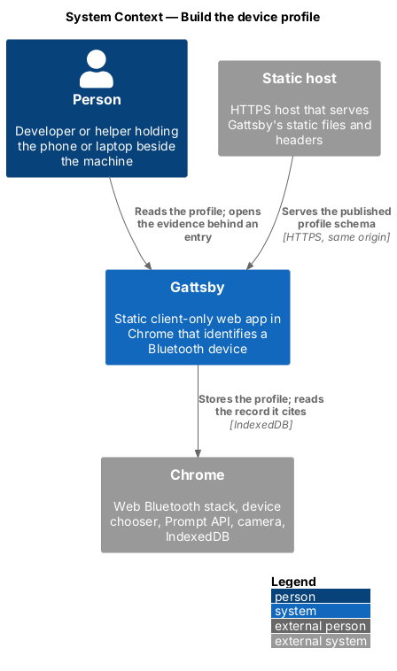
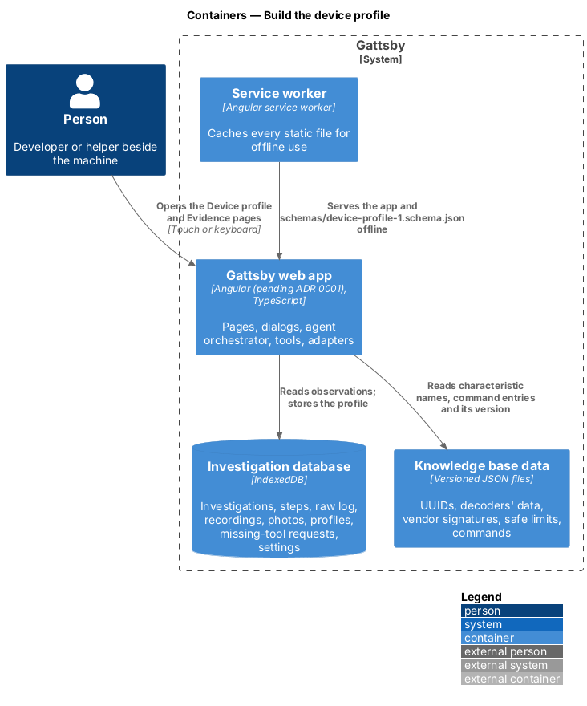
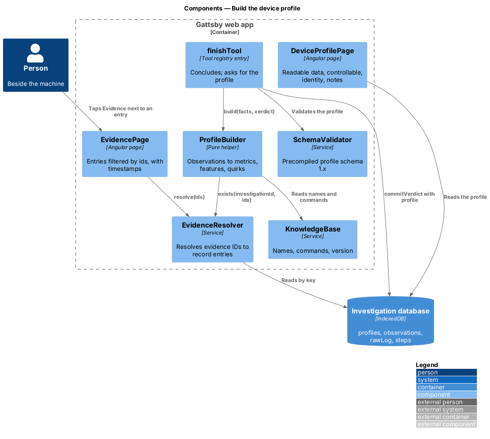
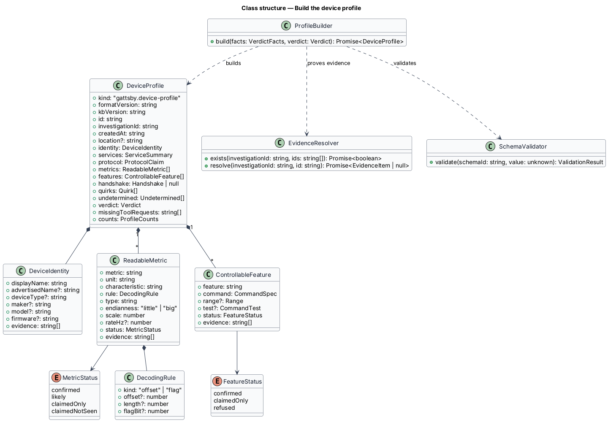
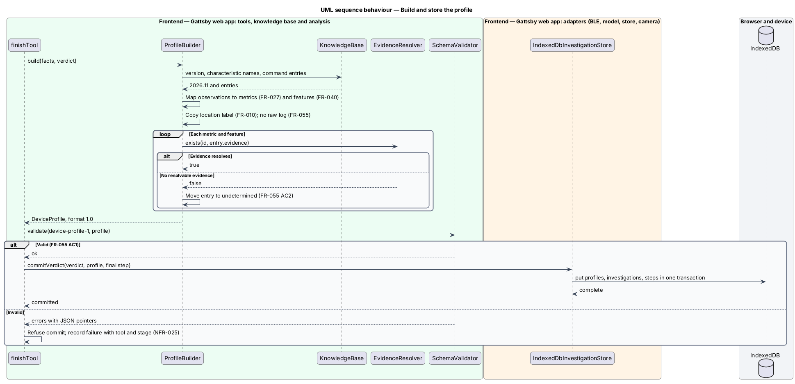
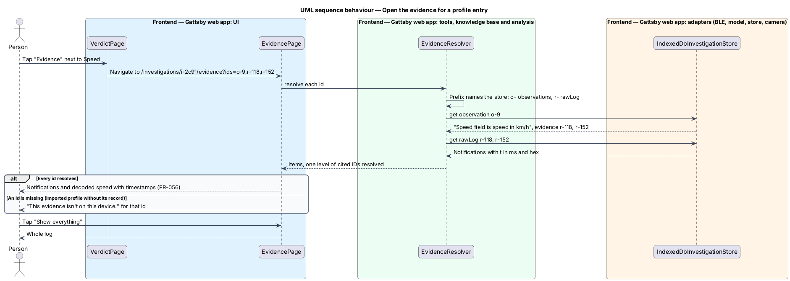

# Build the device profile

## Overview

The device profile is Gattsby's core output: a versioned JSON document that says what the device is,
what it reports and how to decode it, what it can be told to do and how, and which evidence supports
each claim. A developer's own fitness software reads it. This feature builds the profile when the
investigation concludes, keeps it free of the raw log, and links every entry to the evidence in the
investigation record. It belongs to the verdict-and-profile subsystem and runs in the Conclude
stage, inside the `finish` path (see the issue-the-verdict design).

**device profile** — exportable result of one investigation: identity, services, protocol,
readable metrics with decoding rules, controllable features with commands, handshake, quirks,
verdict and evidence references

**decoding rule** — how to read one metric from one characteristic: a fixed byte offset or the flag
bit that places the field, the type, the byte order, the scale and the unit

**investigation record** — every step, action, tool input and output, raw log entry, answer,
hypothesis and missing-tool request of one investigation; the profile cites it and never copies it

**evidence link** — "Evidence" control beside a profile entry that opens the Evidence page filtered
to the entries that support it

The profile appears on the Device profile page (`/profiles/:id`): `docs/mocks/pages/device-profile/default.html`
for a connected treadmill, `partial.html` for a partly decoded rower, `success.html` with the
confirmation "Saved to this device. Next time, reconnect in one tap.", `loading.html`, and
`error.html` for a profile stored in a format this build does not read. The Verdict page shows the
same entries in short form, each with an "Evidence" link (`docs/mocks/pages/verdict/default.html`).
The Evidence page (`docs/mocks/pages/evidence/default.html`) shows what a link opens.

The profile is built by deterministic code from stored observations and the current hypothesis. The
model contributes nothing to it except, through the verdict, a summary line.

## Description

The design introduces these building blocks in the Angular (pending ADR 0001) workspace under
`frontend/src/app/`:

- **`ProfileBuilder`** (`outcome/profile-builder.ts`) — pure function of `VerdictFacts`, the
  investigation and the knowledge base. `build(facts, verdict)` returns a `DeviceProfile` with
  `formatVersion` `1.0` and the knowledge base's `version` (FR-069). It maps observations to
  metrics (FR-027), features (FR-040), quirks and undetermined items, and copies the location label
  from the investigation (FR-010).
- **`EvidenceResolver`** (`outcome/evidence-resolver.ts`) — `resolve(investigationId, id)` returns
  the raw log entry, step, observation, hypothesis version, recording or photo an evidence ID names;
  `exists(investigationId, ids)` checks a list. `ProfileBuilder` uses it to prove each entry's
  evidence before the profile is committed.
- **`SchemaValidator`** (`tools/schema-validator.ts`) — validates the built profile against the
  precompiled profile schema before `commitVerdict` stores it (FR-055 AC1). No `eval` or
  `new Function` runs at run time (NFR-013).
- **Profile JSON Schema** (`frontend/src/schemas/device-profile-1.schema.json`) — the published
  schema, copied to the build output as `schemas/device-profile-1.schema.json` so other apps can
  read it from Gattsby's own origin. The build script `frontend/scripts/compile-schemas.ts`
  precompiles it into a standalone validator module under `frontend/src/app/schemas/generated/`.
- **`DeviceProfilePage`** (`pages/device-profile/device-profile.page.ts`) — lazy route. It loads the
  profile and its investigation's notes through the store and renders the readable data,
  controllable, identity, evidence and notes sections. "Reconnect" and "Investigate again" start a
  new investigation (see the start-an-investigation design).
- **`EvidencePage`** (`pages/evidence/evidence.page.ts`) — opened by an evidence link with the query
  parameter `ids` (for example `/investigations/i-2c91/evidence?ids=o-9,r-118,r-152`). It shows only
  those entries, with timestamps and decoded values, and "Show everything" clears the filter (FR-056
  AC1). The page's other filters and its rendering of the raw log belong to the log-raw-traffic
  design.
- **`VerdictSummary`** and **`ConfidenceBadge`** — render profile entries on the Verdict page with
  their status word and shape.
- **`DeviceProfile`** (`store/model/device-profile.ts`) — domain type, stored in the `profiles`
  object store under `id`, with the unique index `byInvestigation` and the indexes `byCreatedAt` and
  `byDeviceType` (the Saved devices filters).

### Rules the builder enforces

1. One profile per investigation (A-03). It is built once, at conclusion, for every verdict kind,
   including "Stopped by the person" (FR-009 AC3 shows the partial profile).
2. The profile holds no raw log entry, recording or photo. It holds evidence IDs that point into the
   investigation record (FR-055).
3. Every metric and feature carries at least one evidence ID that resolves in its investigation
   record (FR-055 AC2). A metric that is only claimed cites the read of the feature characteristic
   that claims it (for FTMS, Fitness Machine Feature `0x2ACC`). An entry with no resolvable evidence
   moves to `undetermined` with the reason "no evidence recorded"; it never ships as a claim.
4. Metric status is `confirmed` (moved as expected after the person's action, A-12), `likely`
   (decoded but not confirmed), `claimedOnly` (claimed by feature bits, no data yet) or
   `claimedNotSeen` (claimed, and absent from every notification) (FR-027).
5. Feature status is `confirmed` (the device answered success and the effect was confirmed),
   `claimedOnly` (advertised, not tested) or `refused` (the device answered with a non-success
   result code) (FR-040).
6. The protocol's confidence is the current hypothesis's deterministic score (see the
   track-the-hypothesis design).
7. UUIDs are stored in canonical 128-bit lowercase form. The UI shortens Bluetooth SIG base UUIDs to
   the `0x2ACD` form.
8. A built profile that fails its schema is a defect. The commit is refused, and the failure is
   recorded with the tool and stage (NFR-025). How the verdict is then stored is `<TO SUPPLY>`: the
   requirements name no fallback.

### Profile format 1.0

The profile JSON, as stored and as exported (see the export-profiles-and-records design), for the
mocks' treadmill. UUIDs are shortened here for reading; the file holds the 128-bit form.

```json
{
  "kind": "gattsby.device-profile",
  "formatVersion": "1.0",
  "kbVersion": "2026.11",
  "id": "p-7f3c",
  "investigationId": "i-2c91",
  "createdAt": "2026-11-25T14:32:30.000Z",
  "location": "Decathlon, Lille",
  "identity": {
    "displayName": "Horizon T202",
    "advertisedName": "HZN-T202-4F1A",
    "deviceType": "treadmill",
    "maker": "Johnson Health Tech",
    "model": "T202",
    "firmware": "2.14.0",
    "evidence": ["r-14", "r-15", "o-5"]
  },
  "services": {
    "advertised": ["0x1826"],
    "discovered": ["0x1826", "0x180a", "0x180d", "0xfff0"],
    "unreachable": [{ "uuid": null, "reason": "outsideKnownList" }]
  },
  "protocol": { "name": "FTMS", "variant": "Treadmill", "service": "0x1826", "confidence": 0.95, "hypothesisVersion": 6 },
  "metrics": [
    {
      "metric": "speed", "unit": "km/h", "characteristic": "0x2acd",
      "rule": { "kind": "offset", "offset": 2, "length": 2 },
      "type": "uint16", "endianness": "little", "scale": 0.01, "rateHz": 1,
      "status": "confirmed", "evidence": ["o-9", "r-118", "r-152"]
    },
    {
      "metric": "incline", "unit": "%", "characteristic": "0x2acd",
      "rule": { "kind": "flag", "flagBit": 3 },
      "type": "sint16", "endianness": "little", "scale": 0.1, "rateHz": 1,
      "status": "confirmed", "evidence": ["o-11", "r-301"]
    }
  ],
  "features": [
    {
      "feature": "setTargetSpeed",
      "command": { "characteristic": "0x2ad9", "opCode": "0x02", "parameter": { "type": "uint16", "scale": 0.01, "unit": "km/h" } },
      "range": { "min": 0.5, "max": 16.0, "increment": 0.1, "source": "0x2ad4" },
      "test": { "from": 6.0, "to": 5.9, "result": "success" },
      "status": "confirmed", "evidence": ["s-10", "r-298", "r-299"]
    }
  ],
  "handshake": null,
  "quirks": [{ "text": "Accepts one central at a time", "evidence": ["o-2"] }],
  "undetermined": [{ "subject": "Vendor service 0xFFF0", "reason": "no readable data" }],
  "verdict": { "kind": "connected", "label": "Connected — FTMS", "protocol": "FTMS", "summary": "Speed, incline, distance and time came through live, and it obeyed a speed command." },
  "missingToolRequests": ["m-1"],
  "counts": { "steps": 11, "packets": 412, "approvedCommands": 3 }
}
```

| Field | FR-055 item |
|---|---|
| `formatVersion`, `kbVersion` | Profile format version, knowledge-base version |
| `identity` | Device name, maker, model, firmware (and device type) |
| `services.advertised`, `services.discovered`, `services.unreachable` | Advertised and discovered UUIDs, unreachable services (FR-023) |
| `protocol` | Protocol and confidence |
| `metrics[]` | Readable metrics with decoding rules: characteristic, offset or flag rule, type, scale, unit, confirmation |
| `features[]` | Controllable features with command bytes and ranges |
| `handshake` | Required handshake (vendor, characteristic, bytes, source), or `null` |
| `quirks[]` | Connection quirks |
| `verdict`, `createdAt`, `location` | Verdict, date, optional location label |
| `evidence` on every entry | Evidence references |

The schema limits every string (`displayName` and `advertisedName` at most 120 characters, `summary`
at most 280, `text` and `reason` at most 280), sets `additionalProperties: false` on every object,
and requires `kind` and `formatVersion`. Notes are not part of the profile; the export dialog adds
them only when the person ticks "Include notes and photos".

### Evidence IDs and links

Evidence IDs follow the prefix scheme of the track-the-hypothesis design (`r-`, `s-`, `o-`, `h-`,
`rec-`, `ph-`). Observations take their evidence from the tool envelope that created them (see the
return-a-result-envelope design), so every observation, hypothesis version and profile entry cites
the tool calls and raw log entries behind it (FR-056). An "Evidence" link carries the entry's IDs
plus, for an observation, the IDs that observation cites, resolved one level deep.

### States of the Device profile page

| State | Mock | Behaviour |
|---|---|---|
| Loading | `loading.html` | "Loading the device profile" |
| Default | `default.html` | Readable data, Controllable, Identity, Evidence counts, Notes, location and date |
| Partial | `partial.html` | Same sections for a partly decoded profile; "Investigate again" instead of "Reconnect" |
| Success | `success.html` | Confirmation line after the profile is first saved |
| Error | `error.html` | Stored `formatVersion` unreadable and not migratable: "This profile couldn't be opened"; the investigation record stays intact (see the import-profiles-and-records design for migration) |

### Tests that prove it

An acceptance spec runs the scripted FTMS treadmill to its verdict, taps "Evidence" next to speed,
and checks that the notifications and decoded values that confirmed speed appear with timestamps.
Unit tests validate profiles built from scripted facts against the schema, and check that each
metric and feature has evidence that resolves.

## Requirements

The feature realizes the following level-2 (L2) requirements; each refines the level-1 (L1)
requirement cited beside it.

| L2 ID | Refines (L1) | Requirement |
|-------|--------------|-------------|
| [`FR-055`](../../../specs/L2.md#fr-055-build-the-device-profile) | `L1-012` | The device profile must hold: profile format version, knowledge-base version, device name, maker, model, firmware, advertised and discovered UUIDs, unreachable services, protocol and confidence, readable metrics with decoding rules (characteristic, offset or flag rule, type, scale, unit, confirmation), controllable features with command bytes and ranges, required handshake, connection quirks, verdict, evidence references, date, and the optional location label. It must not hold the raw log; that stays in the investigation record. |
| [`FR-056`](../../../specs/L2.md#fr-056-link-evidence-to-the-raw-record) | `L1-012` | Every observation, hypothesis and profile entry must reference the tool calls and raw log entries that support it, and the person must be able to open that evidence from the verdict screen. |

## Diagrams

### System context

The person reads the device profile and opens its evidence in Gattsby; Chrome's IndexedDB holds the
profile and the record it cites.



### Containers

The web app builds the profile from the investigation database and the knowledge base, stores it,
and serves the published profile schema as a static file.



### Components

`ProfileBuilder` maps observations to entries, proves their evidence through `EvidenceResolver`, and
`SchemaValidator` checks the result; the pages read it back and follow evidence links.



### Class structure

`DeviceProfile` composes identity, services, protocol, metrics, features and the verdict; each
metric and feature carries a decoding rule or command and its evidence IDs.



### Behaviour — build and store the profile

At conclusion `ProfileBuilder` maps observations to entries, moves any entry without resolvable
evidence to `undetermined`, validates the profile and hands it to `commitVerdict`.



### Behaviour — open the evidence for an entry

The person taps "Evidence" next to speed; the Evidence page resolves the IDs and shows the
notifications and decoded values with their timestamps.


