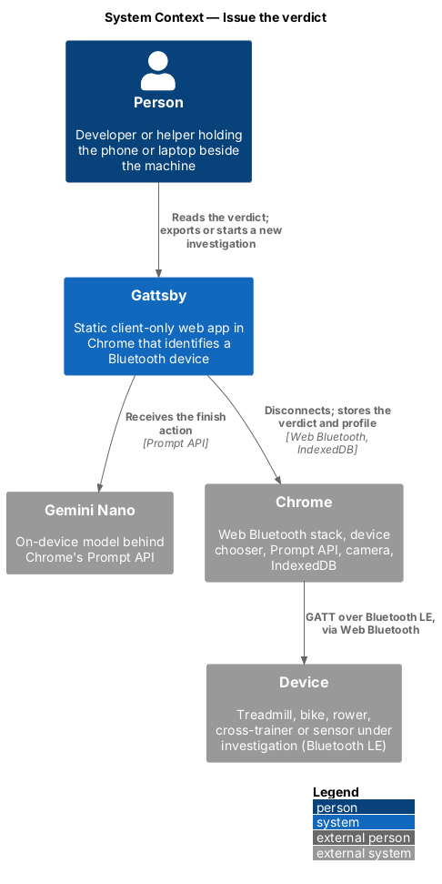
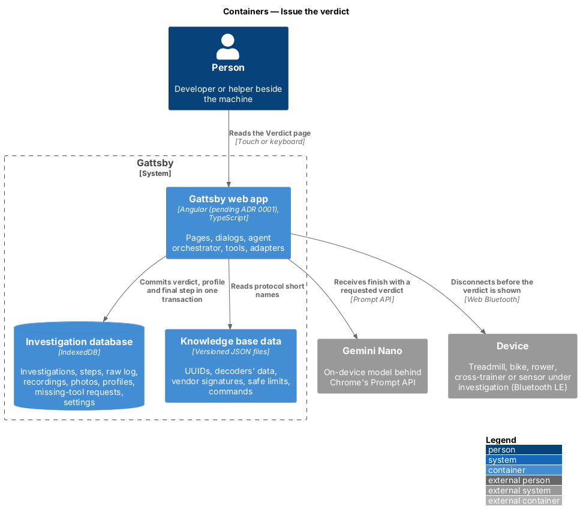
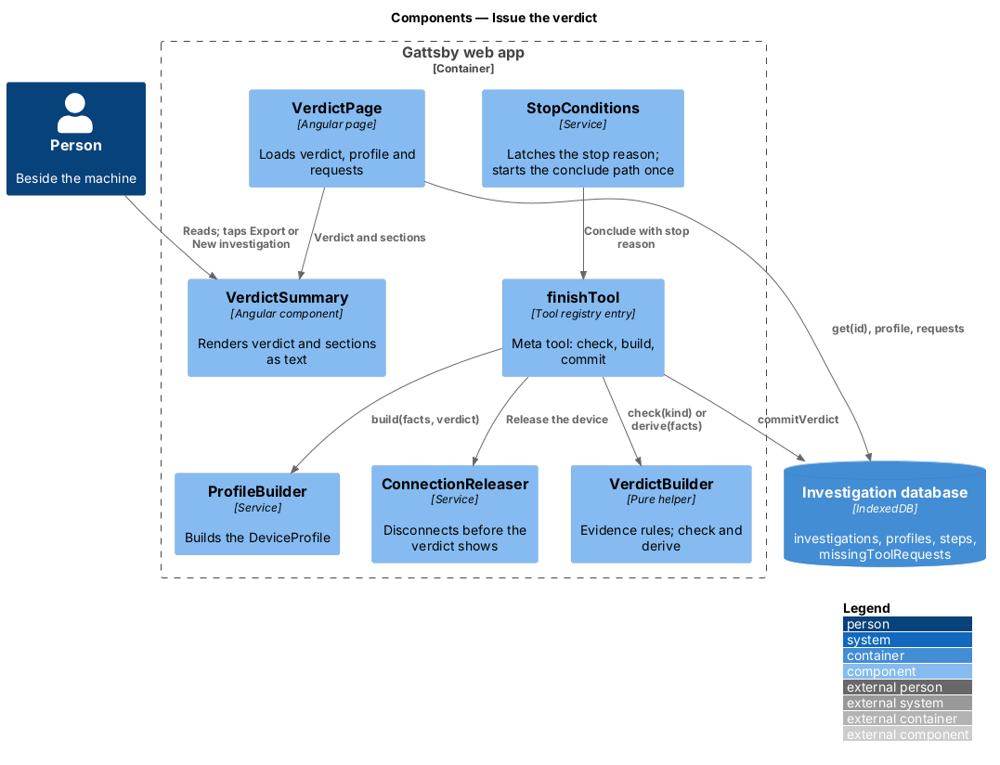
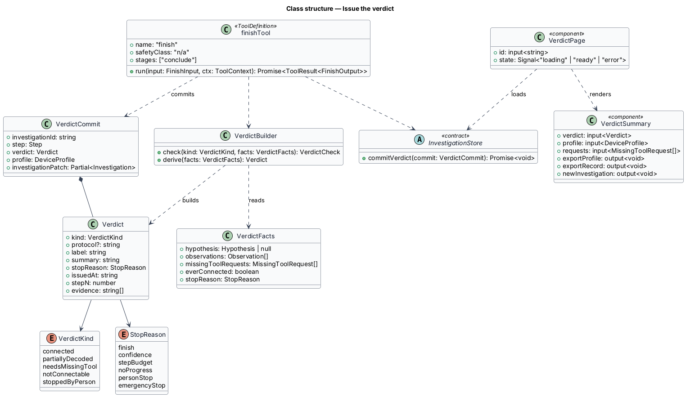
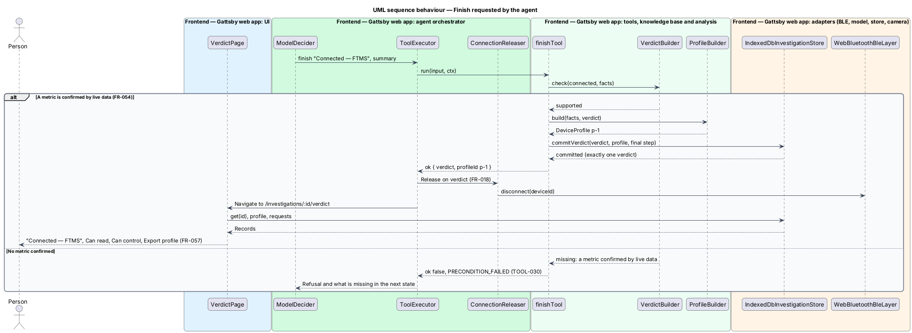
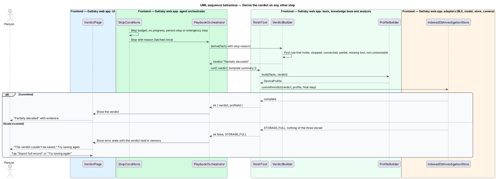

# Issue the verdict

## Overview

Every investigation ends with exactly one verdict. This feature decides which one, checks it
against the evidence, stores it with the device profile in one transaction, and shows it. It belongs
to the verdict-and-profile subsystem and runs in the Conclude stage of the playbook, whatever ended
the loop: the agent's `finish` action (TOOL-030), the confidence threshold, the step budget, no
progress, the person's stop or an emergency stop (see the end-the-loop design).

**verdict** — one-line outcome that ends an investigation, chosen from a fixed set of five kinds

**verdict kind** — one of `connected`, `partiallyDecoded`, `needsMissingTool`, `notConnectable` and
`stoppedByPerson`, each with a label and an evidence rule

**evidence rule** — deterministic condition on the investigation's observations and requests that a
verdict kind needs before it may be issued

**stop reason** — recorded cause of the loop's end: `finish`, `confidence`, `stepBudget`,
`noProgress`, `personStop` or `emergencyStop`

The Verdict page (`/investigations/:id/verdict`) shows the result. Its mocks cover each kind:
*Connected — FTMS* (`docs/mocks/pages/verdict/default.html`), *Partially decoded*
(`partial.html`), *Needs a missing tool* (`missing-tool.html`), *Not connectable*
(`not-connectable.html`) and *Stopped by the person* (`stopped.html`), plus `loading.html`
("Building the verdict") and `error.html` ("This verdict couldn't be saved."). The page shows the
verdict, the device's identity, what can be read, what can be controlled, what could not be
determined, any missing-tool requests, and the actions "Export profile", "Export full record" and
"New investigation" (FR-057).

The model may ask for a verdict, but code decides whether the evidence supports it. "Connected —
FTMS" with no metric confirmed by live data is refused, and the agent is told what is missing. On
every stop other than `finish`, code derives the verdict from what is known, so no investigation
ends without one.

## Description

The design introduces these building blocks in the Angular (pending ADR 0001) workspace under
`frontend/src/app/`:

- **`finishTool`** (`tools/meta/finish.tool.ts`) — registry entry of group `Meta`, safety class
  `n/a`, allowed only at stage `conclude` and by the orchestrator's own conclude path. Input
  `{ verdict, summary }` (summary at most 280 characters); output `{ verdict, profileId }`. It asks
  `VerdictBuilder` to check the requested kind, asks `ProfileBuilder` for the profile, and commits
  both.
- **`StopConditions`** (`agent/stop-conditions.ts`) — on any stop other than `finish`, hands the
  stop reason to the orchestrator, which calls `finishTool` with a verdict that `VerdictBuilder`
  derives (FR-045). It latches, so the conclude path runs once.
- **`VerdictBuilder`** (`outcome/verdict-builder.ts`) — pure helper over a `VerdictFacts` snapshot
  (hypothesis, observations, missing-tool requests, connection history, stop reason).
  `check(kind, facts)` returns `supported` or the missing evidence; `derive(facts)` returns the one
  verdict the evidence supports, in the precedence below.
- **`ProfileBuilder`** (`outcome/profile-builder.ts`) — builds the `DeviceProfile` from the same
  facts (see the build-the-device-profile design).
- **`InvestigationStore.commitVerdict(commit)`** (`store/investigation-store.ts`) — writes the
  verdict onto the `investigations` record, the profile into `profiles` and the final step into
  `steps` in one `readwrite` transaction. It refuses a second verdict for the same investigation
  with the store code `ALREADY_CONCLUDED`.
- **`ConnectionReleaser`** (`agent/connection-releaser.ts`) — disconnects before the Verdict page
  appears (FR-018; `loading.html` notes "The device is already disconnected when the verdict screen
  appears").
- **`VerdictPage`** (`pages/verdict/verdict.page.ts`) — lazy route. It loads the investigation, its
  profile and its missing-tool requests through the store and passes them to presentation
  components. It opens `ExportDialog` for both export actions (see the export-profiles-and-records
  design) and starts a new investigation through `AgentOrchestrator`.
- **`VerdictSummary`** (`ui/verdict-summary/verdict-summary.component.ts`) — presentation
  component. Inputs: the `Verdict`, the identity line and the profile sections. It renders the
  verdict label, the summary, the protocol and the sections as text, never as HTML (NFR-013).
- **`ConfidenceBadge`** (`ui/confidence-badge/confidence-badge.component.ts`) — renders each item's
  status (*confirmed*, *likely*, *guess*, *claimed only*) as a word and a shape.
- **`Verdict`** (`store/model/verdict.ts`) — domain type.

### Verdict kinds and their evidence rules

| Kind | Label (provisional, OQ-06) | Evidence rule |
|---|---|---|
| `connected` | "Connected — *protocol*" | The hypothesis names a protocol in the knowledge base, and at least one metric is confirmed by live data (A-12) |
| `partiallyDecoded` | "Partially decoded" | At least one field was decoded or found varying with the person's effort |
| `needsMissingTool` | "Needs a missing tool" | The investigation holds at least one missing-tool request |
| `notConnectable` | "Not connectable" | No connection to the device succeeded (see the conclude-not-connectable design) |
| `stoppedByPerson` | "Stopped by the person" | The stop reason is `personStop` (FR-009); neither the model nor the checklist may request it |

The protocol in the label is the knowledge base's short name for the hypothesis's protocol:
"FTMS", "Heart Rate", "Cycling Power", "Cycling Speed and Cadence", "Running Speed and Cadence".
The wording for sensors that are not machines is open (OQ-11).

### Rules the builder enforces

1. An investigation holds exactly one verdict (FR-054 AC3). `StopConditions` latches, and
   `commitVerdict` refuses a second one.
2. A requested kind whose evidence rule fails is refused with `PRECONDITION_FAILED`. The message
   names what is missing, for example "Connected — FTMS needs at least one metric confirmed by live
   data; none is." The refusal counts as a step, and the loop continues (TOOL-030 AC1).
3. A requested kind whose rule holds is issued as requested.
4. On any other stop, `derive` picks the first kind whose rule holds, in this order:
   `stoppedByPerson`, `connected`, `partiallyDecoded`, `needsMissingTool`, `notConnectable`.
5. A connected device with nothing decoded, nothing varying and no missing-tool request supports no
   kind. The design proposes `needsMissingTool`, with a request "Decode service *UUID*" recorded for
   each unknown service; this extends FR-058's list of triggers and is `<TO SUPPLY>` for
   confirmation.
6. An emergency stop derives the verdict like any other stop and records `emergencyStop` as the stop
   reason, shown in the summary.
7. The summary comes from the `finish` action in full agent mode, and from a per-kind template in
   checklist mode or on a derived verdict. It is at most 280 characters and is shown as text.
8. The verdict, the profile and the final step are committed together. If the commit fails, nothing
   of the three is stored, and the Verdict page shows its error state.

### What the Verdict page shows

| Section | Source |
|---|---|
| Identity line ("Horizon T202 treadmill · Johnson Health Tech · firmware 2.14.0 · 6 min · 11 steps") | Profile identity; investigation start, end and step count |
| Verdict label and summary | `Verdict` |
| Protocol ("FTMS · Treadmill (0x1826)"; "not verified" when stopped) | Profile protocol |
| Missing-tool request raised, with "See all requests" | The investigation's `MissingToolRequest`s; the link opens `/missing-tools` |
| Can read, Can control | Profile metrics and features, each with status and an "Evidence" link (FR-056) |
| Observed | Observations shown instead of metrics for `needsMissingTool`, `notConnectable` and `stoppedByPerson` |
| Couldn't determine | Profile `undetermined` entries |
| Suggested next steps (`partial.html`), What might work instead (`not-connectable.html`) | Per-kind text; the source of device-specific suggestions is `<TO SUPPLY>` (no requirement names one) |
| "Saved to this device as a device profile. Open the device profile" | Link to `/profiles/:id` |

### States

| State | Mock | Behaviour |
|---|---|---|
| Loading | `loading.html` | "Building the verdict" while the conclude path runs; the device is already disconnected |
| Default and the four other kinds | `default.html`, `partial.html`, `missing-tool.html`, `not-connectable.html`, `stopped.html` | As above |
| Error | `error.html` | `commitVerdict` failed with `STORAGE_FULL`: "This verdict couldn't be saved." with "Try saving again" and "Open past investigations"; "Export full record" stays available and exports the stored steps with the verdict held in memory |

### Data shapes

| Type | Fields |
|---|---|
| `Verdict` | `kind`, `protocol?`, `label`, `summary`, `stopReason`, `issuedAt`, `stepN`, `evidence: string[]` |
| `VerdictFacts` | `hypothesis`, `observations`, `missingToolRequests`, `everConnected`, `stopReason` |
| `VerdictCommit` | `investigationId`, `step`, `verdict`, `profile`, `investigationPatch` (`status` `concluded` or `stopped`, `endedAt`) |

### Errors

| Code | Raised by | Meaning to the person |
|---|---|---|
| `PRECONDITION_FAILED` | `finishTool` via `VerdictBuilder` | Not shown as an error; the activity feed records the refused `finish` and the agent continues |
| `STORAGE_FULL` | `commitVerdict` | "This device's storage for Gattsby is full. Export the full record now so nothing is lost, then delete old investigations to make room." |
| `ALREADY_CONCLUDED` | `commitVerdict` | Never expected in use; recorded with tool and stage (NFR-025) |

### Tests that prove it

Acceptance specs run the scripted FTMS treadmill to "Connected — FTMS" with speed and distance
confirmed and the "Export profile" button shown, and the scripted heart-rate strap to "Connected —
Heart Rate" with live BPM. A spec has the fake `LanguageModel` return `finish` with "Connected —
FTMS" before any confirmation and checks the refusal. Unit tests cover `VerdictBuilder.derive` for
each stop reason and each evidence rule.

### Built in journey 2

`finish`, `VerdictBuilder` and the Verdict page are built as the open questions below describe. When the evidence supports no verdict, `finish` raises the request that blocked it (rule 5): one "Decode service *UUID*" per unknown service, or else "Identify this device’s protocol". The page is the error, default and loading states; the stopped, not-connectable and missing-tool states render through the same template.

### Open questions

1. **The verdict for an identified but unconfirmed protocol (journey 2).** Until live data can be
   confirmed (journey 3), no investigation can earn "Connected — *protocol*": FR-054 and TOOL-030
   need at least one metric confirmed by live data. Journey 2 therefore issues **"Partially
   decoded"** for a device whose protocol the rules named. Its evidence rule holds, because the
   Identify stage decodes fields with the knowledge base's decoders (Device Information strings, the
   Fitness Machine Feature bits, the Body Sensor Location), and the summary says what is missing:
   "Identified as FTMS from its services and Device Information. No metric has been confirmed with
   live data yet." "Needs a missing tool" was rejected: confirming live data is a capability that is
   being built, not one the agent lacks, and a request for it would mislead the missing-tool list.
   Journey 3 adds the Standard path and with it "Connected — *protocol*"; the precedence above
   then issues it ahead of "Partially decoded" without a change to `VerdictBuilder`.
2. **Profile and export (journey 4).** Until the device profile exists, `commitVerdict` stores the
   verdict and the final step without a profile, `profileId` stays `null`, and the Verdict page
   shows the identity, the verdict, the protocol, what was observed and what couldn't be
   determined, with "New investigation" as its only action. "Export profile", "Export full record"
   and the "Saved to this device as a device profile" line arrive with journey 4.

## Requirements

The feature realizes the following level-2 (L2) requirements; each refines the level-1 (L1)
requirement cited beside it.

| L2 ID | Refines (L1) | Requirement |
|-------|--------------|-------------|
| [`FR-054`](../../../specs/L2.md#fr-054-issue-one-verdict) | `L1-012` | Every investigation must end with exactly one verdict from this set (wording provisional; OQ-06): Connected — *protocol* (for example "Connected — FTMS") — A known protocol was identified and at least one metric confirmed by live data; Partially decoded — Some fields were decoded or found varying, but not enough for a known protocol; Needs a missing tool — Progress was blocked by a capability Gattsby lacks; Not connectable — No Bluetooth Low Energy device was found or reachable; Stopped by the person — The person stopped before a verdict. |
| [`FR-057`](../../../specs/L2.md#fr-057-show-the-verdict) | `L1-012` | The verdict screen must show the verdict, the device's identity, what can be read, what can be controlled, any missing-tool requests, and actions to export the profile, export the full record and start a new investigation. |
| [`TOOL-030`](../../../specs/L2.md#tool-030-finish) | `L1-012` | Issues the verdict and builds the device profile (FR-054, FR-055). The verdict is checked against the evidence: "Connected — *protocol*" needs at least one metric confirmed by live data. |

## Diagrams

### System context

The model may ask for a verdict; Gattsby checks it, releases the device through Chrome, stores the
verdict and shows it to the person.

### Containers

The web app reads the protocol's short name from the knowledge base and commits the verdict and the
profile to the investigation database in one transaction.

### Components

`finishTool` asks `VerdictBuilder` to check or derive the verdict and `ProfileBuilder` for the
profile, then commits both; `VerdictPage` reads them back and renders them through `VerdictSummary`.

### Class structure

`VerdictBuilder` turns `VerdictFacts` into one `Verdict` of a `VerdictKind`; `finishTool` commits a
`VerdictCommit` through the `InvestigationStore` contract.

### Behaviour — finish requested by the agent

The model returns `finish` with "Connected — FTMS"; with a confirmed metric the verdict is stored and
shown, and without one it is refused with `PRECONDITION_FAILED`.

### Behaviour — derive the verdict on any other stop

The step budget, no progress, the person's stop or an emergency stop end the loop; `VerdictBuilder`
derives the one verdict the evidence supports, and a full disk shows the error state.

