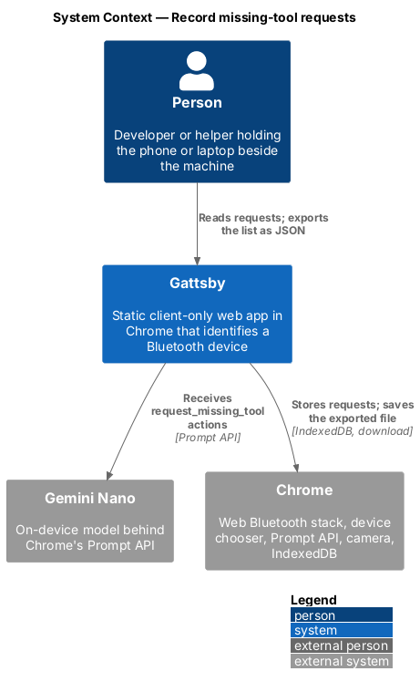
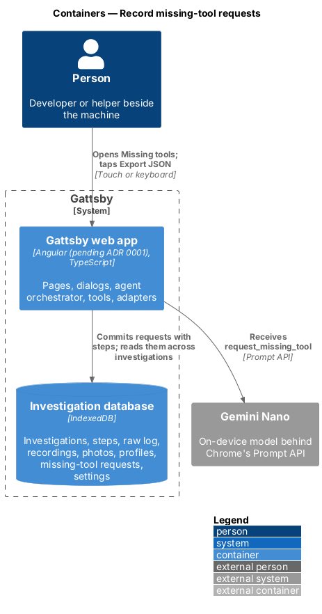
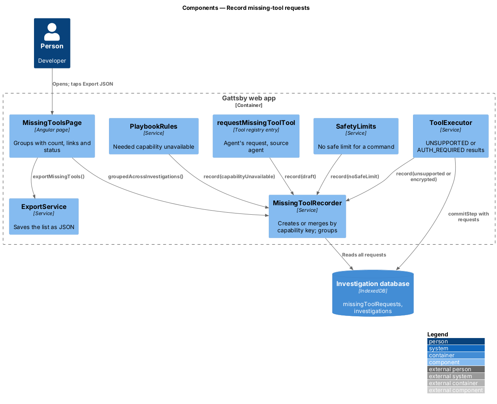
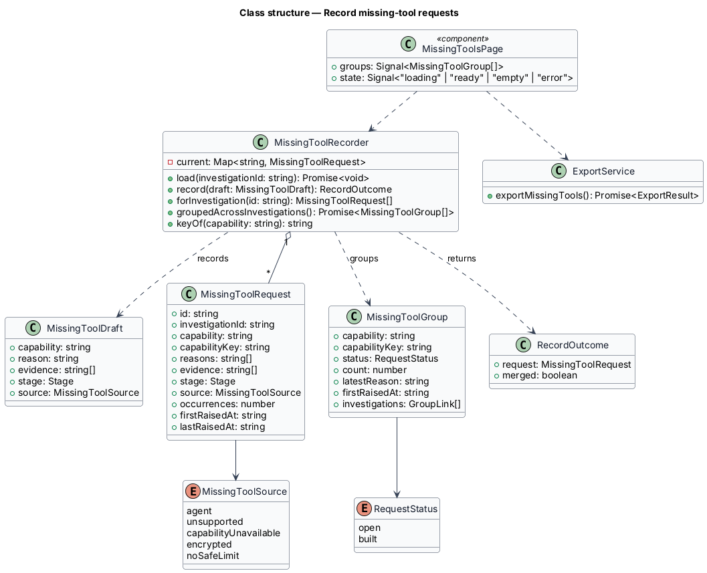
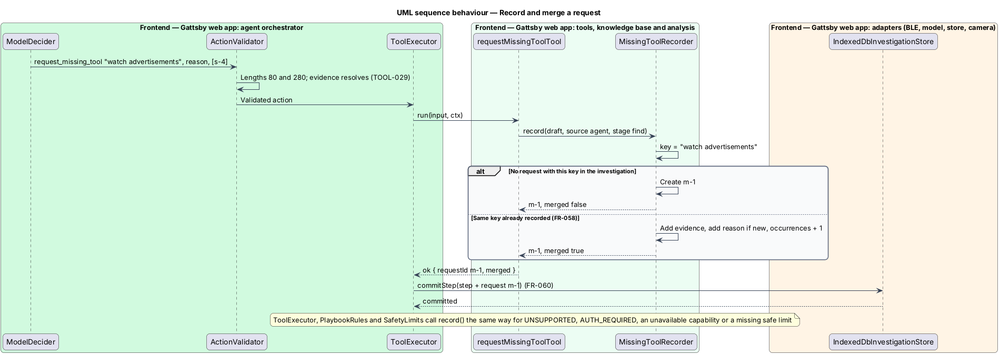
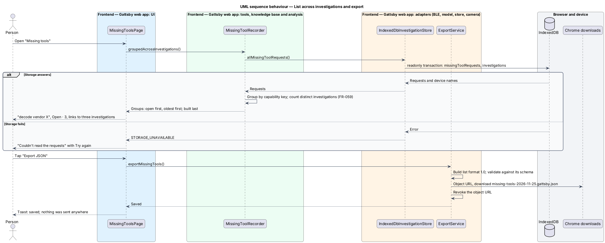

# Record missing-tool requests

## Overview

When an investigation stalls for want of a capability Gattsby does not have, that gap is worth as
much as a verdict: it tells the owner which tool to build next. This feature records each such gap
as a missing-tool request with its reason and evidence, merges repeats within an investigation, and
lists every request across all stored investigations. It belongs to the verdict-and-profile
subsystem and runs at every stage of the playbook.

**missing-tool request** — record of one capability the agent lacked in one investigation: the
capability, the reasons, the evidence references, the stage and the source that raised it

**capability key** — normalised form of a capability's wording that decides when two requests are
the same

**request group** — every request across stored investigations that shares one capability key,
shown once with a count

Requests appear in three places. The Verdict page shows the investigation's requests under "Missing-tool
request raised", with "See all requests" (`docs/mocks/pages/verdict/default.html`,
`missing-tool.html`). The Home page shows the count ("3 missing-tool requests",
`docs/mocks/pages/home/default.html`). The Missing tools page (`/missing-tools`) lists every request
group with its status, count, latest reason, the investigations that raised it and the date it was
first raised, and offers "Export JSON" (`docs/mocks/pages/missing-tools/default.html`, with
`loading.html`, `empty.html` and `error.html`).

A request is raised in five ways (FR-058): the agent asks for one with `request_missing_tool`
(TOOL-029); a tool reports `UNSUPPORTED`; a capability the playbook needs is unavailable; the
protocol is encrypted; or a command has no safe limit. The last four are raised by code, so a request
exists even in checklist mode.

## Description

The design introduces these building blocks in the Angular (pending ADR 0001) workspace under
`frontend/src/app/`:

- **`requestMissingToolTool`** (`tools/meta/request-missing-tool.tool.ts`) — registry entry of
  group `Meta`, safety class `n/a`, allowed at every stage. Input `{ capability (≤ 80 characters),
  reason (≤ 280 characters), evidence: [id] }`; output `{ requestId, merged }`. It hands the draft to
  `MissingToolRecorder` with source `agent`.
- **`MissingToolRecorder`** (`outcome/missing-tool-recorder.ts`) — holds the current investigation's
  requests in memory (loaded on start and resume), and `record(draft)` either creates a request or
  merges the draft into the one with the same capability key. The created or merged request travels
  in the step's `StepCommit`, so it is written with the step (FR-060).
  `groupedAcrossInvestigations()` reads every stored request and returns `MissingToolGroup`s.
- **`ToolExecutor`** (`agent/tool-executor.ts`) — after a tool returns `UNSUPPORTED` or
  `AUTH_REQUIRED`, calls `record` with source `unsupported` or `encrypted` and the envelope's
  evidence.
- **`PlaybookRules`** (`agent/playbook-rules.ts`) — when a rule needs a tool whose required
  capability is unavailable (for example `watch_advertisements` to tell candidates apart), records a
  request with source `capabilityUnavailable` (FR-058 AC1).
- **`SafetyLimits`** (`agent/safety-limits.ts`) — when it refuses a command with `UNSAFE_VALUE`
  because no safe limit exists for it, records a request with source `noSafeLimit` (see the
  keep-commands-conservative design).
- **`MissingToolsPage`** (`pages/missing-tools/missing-tools.page.ts`) — lazy route. It shows the
  request groups, links each investigation to its Verdict page, and calls
  `ExportService.exportMissingTools()` for "Export JSON".
- **`ExportService`** (`store/export-service.ts`) — builds the list file and saves it through a
  download link (see the export-profiles-and-records design).
- **`MissingToolRequest`** (`store/model/missing-tool-request.ts`) — domain type.

### Wording of requests raised by code

| Source | Capability (provisional, A-01) | Reason |
|---|---|---|
| `capabilityUnavailable` | The capability's plain name, for example "watch advertisements" | What the playbook needed it for, for example "Four candidates look alike; advertisement data would tell them apart." |
| `unsupported` | The tool's plain name, for example "read a photo of the model plate" | The envelope's error message |
| `encrypted` | "Decrypt *vendor or service* packets", for example "Decrypt Kingsmith FE00 packets" | What the analysis saw, for example that bytes look random while timing tracks speed |
| `noSafeLimit` | "Safe limit for *command* on a *device type*" | The command that was refused |
| `agent` | As the model wrote it | As the model wrote it |

The capability and reason are rendered as text, never as HTML (NFR-013).

### Rules the recorder enforces

1. The capability key is the capability in Unicode NFKC form, lower-cased, with runs of white space
   collapsed to one space and trailing punctuation removed.
2. Within one investigation, a draft whose key matches an existing request merges into it: its
   evidence IDs are added without duplicates, its reason is added when it differs, `occurrences`
   rises by 1 and `lastRaisedAt` moves. The output's `merged` is `true` (TOOL-029 AC1; FR-058 AC2).
3. A draft's evidence IDs shall resolve in the investigation; `ActionValidator` refuses an agent's
   request with an unresolved ID, or a capability or reason over its length limit, with
   `INVALID_INPUT`.
4. The unique index `byInvestigationAndKey` makes a second request with the same key in one
   investigation impossible at the database level as well.
5. Across investigations, requests with the same key form one group. Its count is the number of
   distinct investigations that raised it (FR-059 AC1); the mock labels it "devices".
6. Groups are listed with open requests first, ordered by the date first raised, oldest first, and
   built requests last, as the mock shows.
7. Deleting an investigation deletes its requests; groups are recounted on the next read.
8. A request's status is `open` or `built`. The mock shows "Built", but no requirement says how a
   request becomes built. The design proposes that a registry tool or knowledge-base decoder declare
   the capability keys it resolves, and that a group show "Built" when one does; this is
   `<TO SUPPLY>`.

### Storage

Requests live in the `missingToolRequests` object store under the key `[investigationId, id]`, where
`id` is `m-` plus a sequence number within the investigation, so it doubles as an evidence ID. The
store has the index `byCapabilityKey` and the unique compound index `byInvestigationAndKey`
(`[investigationId, capabilityKey]`). `groupedAcrossInvestigations()` reads the store with one
`readonly` transaction over `missingToolRequests` and `investigations` (for device names and dates).

### Data shapes

| Type | Fields |
|---|---|
| `MissingToolRequest` | `id`, `investigationId`, `capability`, `capabilityKey`, `reasons: string[]`, `evidence: string[]`, `stage`, `source`, `occurrences`, `firstRaisedAt`, `lastRaisedAt` |
| `MissingToolGroup` | `capability`, `capabilityKey`, `status`, `count`, `latestReason`, `firstRaisedAt`, `investigations: { id, deviceName, raisedAt }[]` |

### Missing-tool list format 1.0

"Export JSON" saves `missing-tools-2026-11-25.gattsby.json`:

```json
{
  "kind": "gattsby.missing-tool-requests",
  "formatVersion": "1.0",
  "kbVersion": "2026.11",
  "exportedAt": "2026-11-25T14:40:00.000Z",
  "requests": [
    {
      "capability": "Decrypt Kingsmith FE00 packets",
      "capabilityKey": "decrypt kingsmith fe00 packets",
      "status": "open",
      "count": 2,
      "firstRaisedAt": "2026-11-10T16:05:12.000Z",
      "stages": ["proprietary"],
      "sources": ["encrypted"],
      "reasons": ["Notifications on 0xFE01 change with speed but every byte looks random."],
      "investigations": [
        { "id": "i-81d0", "deviceName": "KS-AP-R3", "raisedAt": "2026-11-10T16:05:12.000Z", "evidence": ["o-14", "rec-3"] }
      ]
    }
  ]
}
```

Its schema is `frontend/src/schemas/missing-tool-requests-1.schema.json`. The list is an export
only; the import-profiles-and-records design does not read it.

### Errors

| Code | Raised by | Meaning to the person |
|---|---|---|
| `INVALID_INPUT` | `ActionValidator` | A refused step in the activity feed |
| `STORAGE_UNAVAILABLE` | `InvestigationStore` | "Couldn't read the requests. Chrome didn't answer when Gattsby opened its storage. Nothing has been lost." with "Try again" (`error.html`) |

### Tests that prove it

An acceptance spec seeds three stored investigations that raised "decode vendor X" and checks that
the Missing tools page shows it once with the count 3 and links to the three. Another runs the
scripted look-alike candidates with advertisement watching unavailable and checks the "watch
advertisements" request and its reason. Unit tests cover key normalisation and merging.

## Requirements

The feature realizes the following level-2 (L2) requirements; each refines the level-1 (L1)
requirement cited beside it.

| L2 ID | Refines (L1) | Requirement |
|-------|--------------|-------------|
| [`FR-058`](../../../specs/L2.md#fr-058-record-a-missing-tool-request) | `L1-013` | Gattsby must record a missing-tool request whenever the agent asks for one, a tool reports `UNSUPPORTED`, a capability is unavailable, a protocol is encrypted, or a safe limit is missing. Each request holds the capability needed, the reason, the evidence references, and the stage. Identical requests in one investigation are merged. |
| [`FR-059`](../../../specs/L2.md#fr-059-list-missing-tool-requests-across-investigations) | `L1-013` | Gattsby must list every missing-tool request across all stored investigations, grouped by capability with a count, and let the person export the list as JSON. |
| [`TOOL-029`](../../../specs/L2.md#tool-029-request_missing_tool) | `L1-013` | Records a capability the agent lacks (FR-058). |

## Diagrams

### System context

The agent or the code raises requests inside Gattsby; Chrome's IndexedDB keeps them, and the person
lists and exports them.



### Containers

The web app takes requests from the model's actions and from its own checks, and stores them in the
investigation database with each step.



### Components

Four sources feed `MissingToolRecorder`, which merges by capability key and puts the request in the
step's commit; `MissingToolsPage` reads the groups and exports them through `ExportService`.



### Class structure

`MissingToolRecorder` creates and merges `MissingToolRequest`s and groups them into
`MissingToolGroup`s; each request records its `MissingToolSource`.



### Behaviour — record and merge a request

The agent asks for "watch advertisements" and the recorder creates a request; a second identical
request in the same investigation merges into it and returns `merged: true`.



### Behaviour — list across investigations and export

The Missing tools page groups every stored request by capability key with a count and links, and
"Export JSON" saves the list as a local file.


