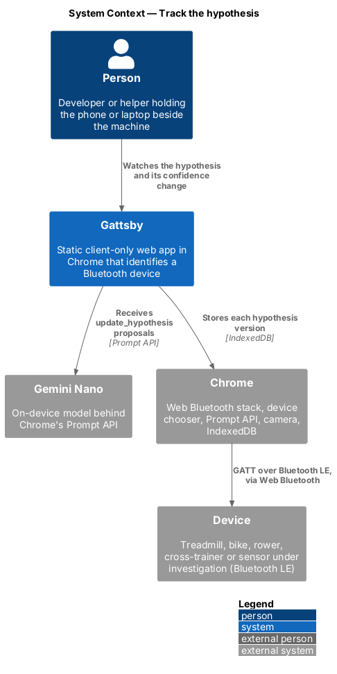
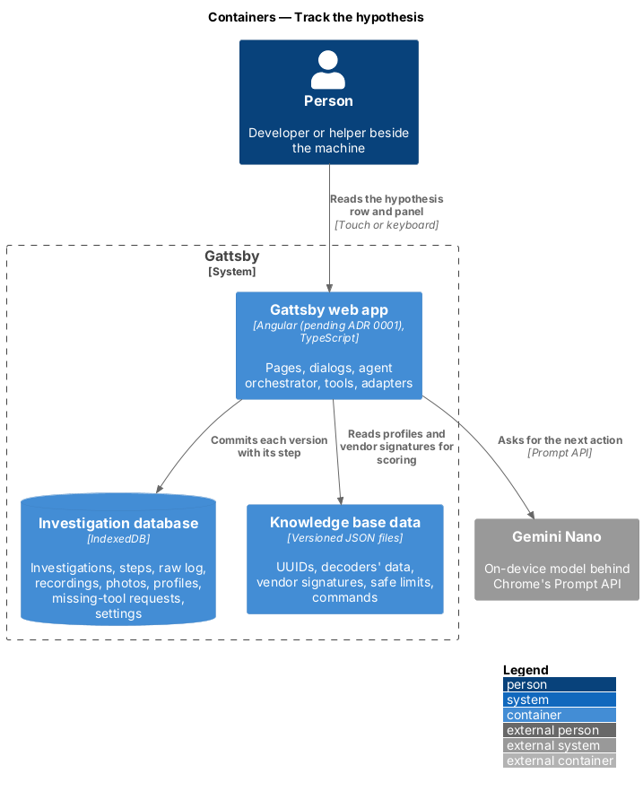
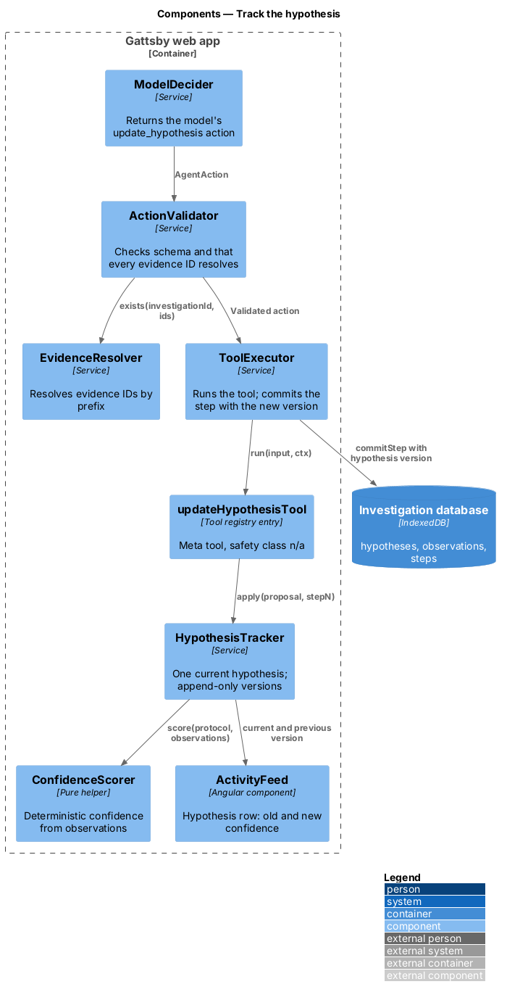
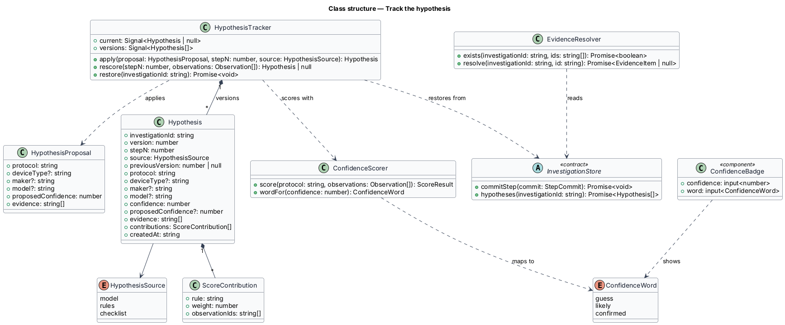
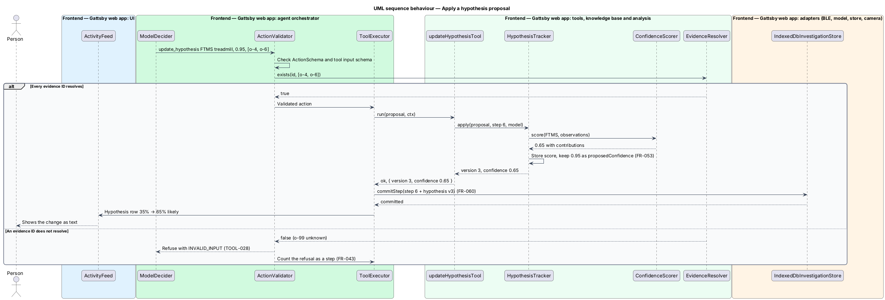
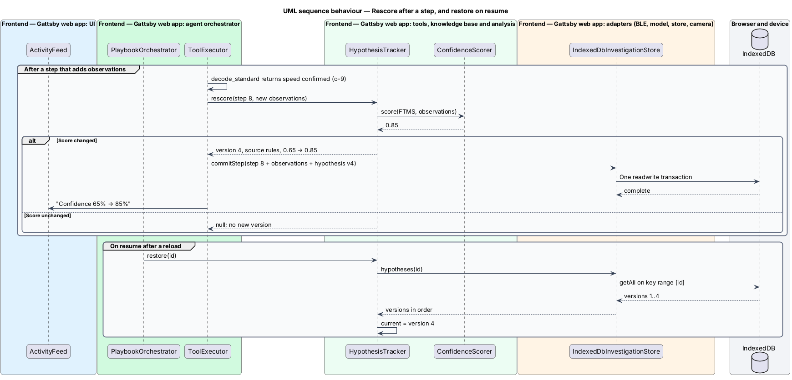

# Track the hypothesis

## Overview

From the Identify stage of the playbook onward, Gattsby holds one guess about what the device is and
how it talks. This feature keeps that guess, scores it, and keeps every earlier version of it, so the
investigation record shows how the guess changed and why. It belongs to the verdict-and-profile
subsystem and runs at every stage from `identify` to `conclude`.

**hypothesis** — current protocol guess for one investigation: protocol, device type, maker, model,
confidence from 0 to 1, and evidence references

**hypothesis version** — immutable copy of the hypothesis as one step left it, numbered from 1

**deterministic score** — confidence that `ConfidenceScorer` computes from stored observations alone,
without the model

**evidence reference** — ID of a raw log entry, tool call, observation or recording that supports a
claim

The person sees the hypothesis on the Investigation page: as a row in the activity feed each time it
changes ("Hypothesis FTMS treadmill, Horizon T-series 35% → 65% likely") and in the hypothesis panel
beside the live readings (`docs/mocks/pages/investigation/default.html`). The first version appears
after `enumerate_gatt`, at 35 % *guess*, in state `identify`
(`docs/mocks/pages/investigation/identify.html`). The Evidence page lists each change with its time
("Speed confirmed (3.0 → 6.0). Confidence 65% → 85%", `docs/mocks/pages/evidence/default.html`).

Two sources change the hypothesis. In full agent mode the model proposes one through an
`update_hypothesis` action (TOOL-028). In both modes, `HypothesisTracker` rescores the current
hypothesis after every step that adds an observation. Either way the stored confidence is the
deterministic score: the model may name a protocol, a maker or a model, but never sets its own
confidence. A small model therefore cannot argue itself past the finish threshold of 0.9 (A-05).

## Description

The design introduces these building blocks in the Angular (pending ADR 0001) workspace under
`frontend/src/app/`:

- **`updateHypothesisTool`** (`tools/meta/update-hypothesis.tool.ts`) — registry entry of group
  `Meta`, safety class `n/a`, allowed at stages `identify`, `standard`, `proprietary`, `control` and
  `conclude`. Its input is TOOL-028's `{ protocol, deviceType?, maker?, model?, proposedConfidence,
  evidence }`; its output is `{ version, confidence }`. It hands the proposal to `HypothesisTracker`.
- **`ActionValidator`** (`agent/action-validator.ts`) — checks the `update_hypothesis` action against
  `ActionSchema` and the tool's input schema, then asks `EvidenceResolver` whether every evidence ID
  resolves in this investigation. An ID that does not resolve refuses the action with
  `INVALID_INPUT` (TOOL-028 AC1); the refusal counts as a step (FR-043).
- **`EvidenceResolver`** (`outcome/evidence-resolver.ts`) — `exists(investigationId, ids)` and
  `resolve(investigationId, id)`. It reads the ID's prefix to find its object store (see
  "Evidence IDs").
- **`HypothesisTracker`** (`outcome/hypothesis-tracker.ts`) — owns the current hypothesis as a
  signal and the ordered list of versions. `apply(proposal, stepN)` scores the proposal and returns
  the new version; `rescore(stepN, observations)` re-runs the score for the current protocol after a
  step; `restore(investigationId)` reloads the versions from the store when an investigation
  resumes. It never writes to IndexedDB itself: each new version travels in the step's
  `StepCommit`.
- **`ConfidenceScorer`** (`outcome/confidence-scorer.ts`) — pure function of the protocol, the
  investigation's observations and the knowledge base. `score(protocol, observations)` returns
  `{ confidence, contributions }`, where each contribution names the rule and the observation IDs
  behind it. It caps nothing it does not compute: the model's number never enters it.
- **`ProfileMatcher`** (`knowledge-base/profile-matcher.ts`) — supplies the 0–100 match score the
  scorer reads from the `match_known_profiles` observation (see the match-known-profiles design).
- **`ToolExecutor`** (`agent/tool-executor.ts`) — runs the tool, wraps its result in the envelope,
  and puts the new hypothesis version in the `StepCommit` it passes to
  `InvestigationStore.commitStep`, so the step and the hypothesis change are written in one
  transaction (FR-060; see the save-as-the-investigation-runs design).
- **`ActivityFeed`** and **`ConfidenceBadge`** (`ui/activity-feed/activity-feed.component.ts`,
  `ui/confidence-badge/confidence-badge.component.ts`) — presentation components. The feed renders
  a hypothesis row from the previous and new versions; the badge renders a confidence as a word and
  a shape (filled *confirmed*, half *likely*, ring *guess*), never colour alone (NFR-011).
- **`Hypothesis`** (`store/model/hypothesis.ts`) and **`HypothesisProposal`**
  (`store/model/hypothesis-proposal.ts`) — domain types.

### Rules the tracker enforces

1. An investigation has one current hypothesis. Versions are append-only and numbered from 1; a
   version is never edited or deleted while the investigation exists.
2. Each version records the step number that produced it, its source (`model`, `rules` or
   `checklist`) and the version it replaces.
3. The stored `confidence` is always the deterministic score for the proposed protocol (FR-053 AC2).
   The model's figure is kept as `proposedConfidence` for the record and is shown nowhere else.
4. The stored evidence is the proposal's evidence plus every observation ID the scorer used, so each
   version carries what supports its score.
5. A proposal that changes no field and no score adds no version. The tool returns the current
   version, and the step adds no observation (the end-the-loop design counts it toward no progress).
6. After every committed step that adds an observation, the tracker rescores the current protocol.
   Before `match_known_profiles` has run, the current protocol is the first standard service in the
   layout that the knowledge base gives profiles for (so the mocks' "Standard fitness machine (FTMS)"
   appears after `enumerate_gatt`); afterwards it is the top candidate's protocol and device type.
   A changed score adds a version with source `rules`; this is how "Confidence 65% → 85%" appears
   after `decode_standard` without a model action.
7. In checklist mode, `ChecklistDecider` issues the same `update_hypothesis` action from
   `PlaybookRules`, with source `checklist` and no `proposedConfidence`.
8. On resume, `restore` reloads every version from the `hypotheses` object store in version order;
   the current hypothesis is the highest version.

### Deterministic score

`ConfidenceScorer` sums the contributions below for the proposed protocol and clamps the result to
the range 0 to 1. The weights are a proposal, calibrated to the mocks' progression (35 % after the
layout, 65 % after Device Information and the profile match, 85 % after a confirmed metric); their
sign-off is `<TO SUPPLY>`. They are code constants in `ConfidenceScorer`, not model input.

| Contribution | Observation it reads | Weight |
|---|---|---|
| The protocol's service is in the GATT layout | `enumerate_gatt` service observation | 0.35 |
| Maker or name agrees with a known profile or vendor signature for the protocol | `read_device_info`, `vendor_signature_lookup` | 0.15 |
| `match_known_profiles` scores a profile of the protocol at 70 or more | profile match observation | 0.15 |
| One data characteristic decodes without `DECODE_ERROR` | `decode_standard` decode observation | 0.10 |
| One metric is confirmed by a physical action (A-12) | metric confirmation observation | 0.10 |
| A second metric is confirmed, or a control-point command is answered with success | confirmation or command observation | 0.10 |

A protocol absent from the knowledge base (a proprietary guess) earns only the last three rows, so
it stays below the finish threshold until a decoder exists for it.

The confidence word follows the score: *guess* below 0.5, *likely* from 0.5, *confirmed* from
`LoopConfig.finishConfidence` (0.9, A-05). The 0.5 boundary matches the mocks (35 % *guess*, 65 %
*likely*) and is `<TO SUPPLY>` for sign-off.

### Evidence IDs

Evidence IDs are unique within one investigation and carry a prefix that names their object store:
`r-` raw log entry (`rawLog`), `s-` step or tool call (`steps`), `o-` observation (`observations`),
`h-` hypothesis version (`hypotheses`), `rec-` recording (`recordings`), `ph-` photo (`photos`). The
same scheme serves the device profile and the evidence page (see the build-the-device-profile
design).

### Data shapes

| Type | Fields |
|---|---|
| `HypothesisProposal` | `protocol`, `deviceType?`, `maker?`, `model?`, `proposedConfidence` (0–1), `evidence: string[]` |
| `Hypothesis` | `investigationId`, `version`, `stepN`, `source`, `previousVersion`, `protocol`, `deviceType?`, `maker?`, `model?`, `confidence`, `proposedConfidence?`, `evidence: string[]`, `contributions: ScoreContribution[]`, `createdAt` |
| `ScoreContribution` | `rule`, `weight`, `observationIds: string[]` |

Versions live in the `hypotheses` object store under the key `[investigationId, version]`; one key
range on the investigation ID reads them in version order (see the save-as-the-investigation-runs
design). The full record export lists them in that order (FR-053 AC1).

### Errors

| Code | Raised by | Meaning to the person |
|---|---|---|
| `INVALID_INPUT` | `ActionValidator` | Shown in the activity feed as a refused step: "The agent cited evidence that doesn't exist; it will try again." (provisional, A-01) |

### Tests that prove it

An acceptance spec drives the fake `LanguageModel` (`e2e/fixtures/fake-language-model.ts`) through
three `update_hypothesis` actions against the scripted FTMS treadmill, exports the record, and checks
three versions with their step numbers and evidence. Unit tests cover `ConfidenceScorer` for a
proposal of 0.95 with no supporting observation (stored 0) and for each contribution row.

### Built in journey 2

`HypothesisTracker` and `ConfidenceScorer` are built; the rules' hypothesis is rescored after every step and committed with it. `update_hypothesis` is registered with its evidence check; proposals from the model arrive with journey 6.

## Requirements

The feature realizes the following level-2 (L2) requirements; each refines the level-1 (L1)
requirement cited beside it.

| L2 ID | Refines (L1) | Requirement |
|-------|--------------|-------------|
| [`FR-053`](../../../specs/L2.md#fr-053-track-the-hypothesis-with-evidence) | `L1-012` | Gattsby must hold one current hypothesis (protocol, maker, model, device type, confidence from 0 to 1, and evidence references) and keep every earlier version with the step that changed it. Confidence is computed by deterministic scoring; the model may propose a hypothesis but not set its confidence above what the scoring supports. |
| [`TOOL-028`](../../../specs/L2.md#tool-028-update_hypothesis) | `L1-012` | Records the current protocol guess with its evidence (FR-053). The stored confidence is the deterministic score, capped by the evidence. |

## Diagrams

### System context

The person watches the hypothesis change in Gattsby; Gemini Nano may propose one, and Chrome stores
each version in IndexedDB.

### Containers

The web app scores each proposal against the knowledge base's profiles and commits each version to
the investigation database with its step.

### Components

`ActionValidator` checks the evidence through `EvidenceResolver`; `updateHypothesisTool` hands the
proposal to `HypothesisTracker`, which takes its confidence from `ConfidenceScorer`; `ToolExecutor`
commits the version with the step.

### Class structure

`HypothesisTracker` owns the ordered `Hypothesis` versions and depends on `ConfidenceScorer` for
every confidence; `Hypothesis` keeps the proposal's figure apart from the stored score.

### Behaviour — apply a proposal from the model

The model proposes "FTMS treadmill" at 0.95; the tracker stores the deterministic 0.65 instead, and
an unresolved evidence ID refuses the action with `INVALID_INPUT`.

### Behaviour — rescore after a step, and restore on resume

After `decode_standard` commits a confirmed metric, the tracker rescores and adds a `rules` version
(65 % → 85 %); on resume it reloads the versions from the store.

